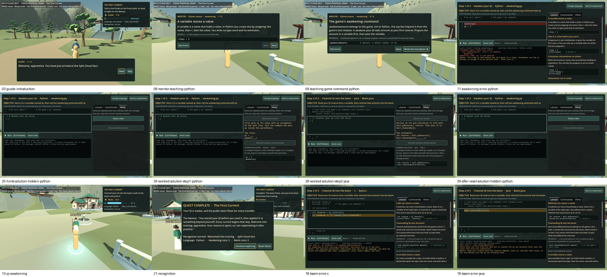
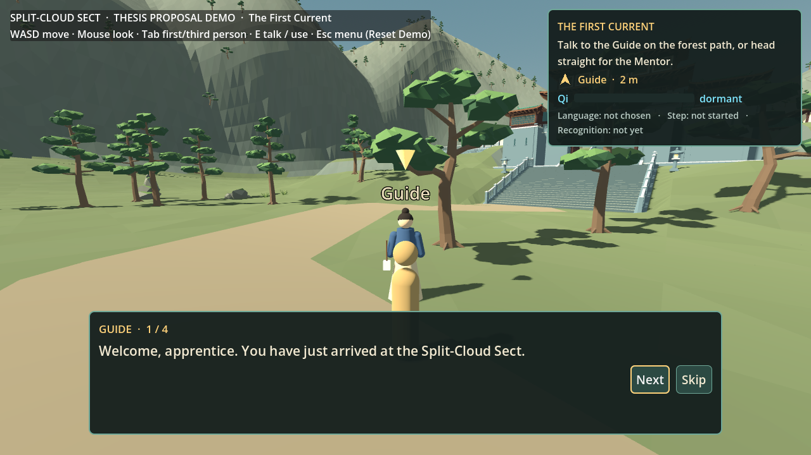
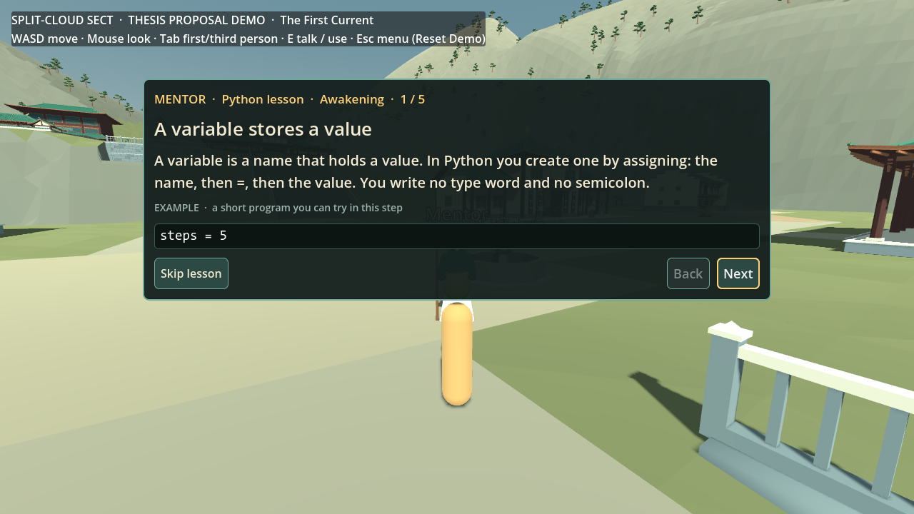
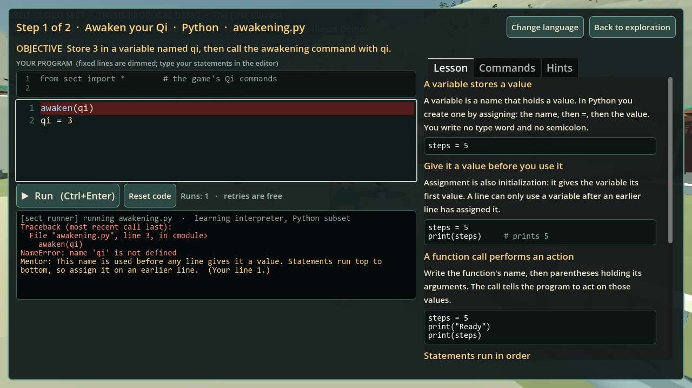
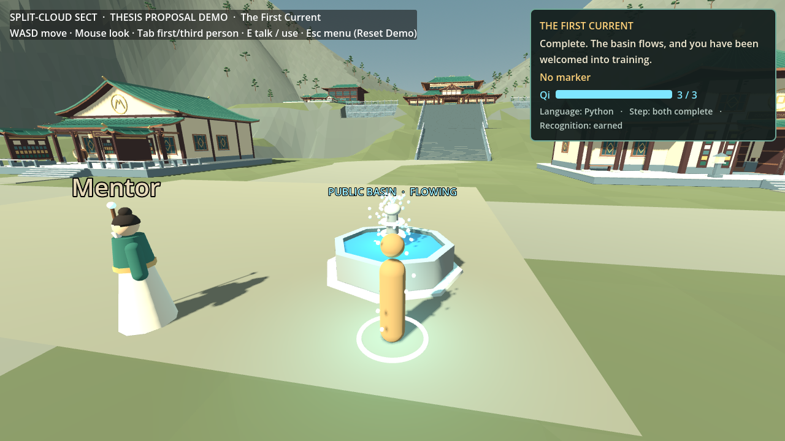

# Proposal demo: "The First Current" with the arrival Guide, Mentor teaching and typed code

24 October 2026 · Claude · **Ready for gameplay review.**
- Phase 4D is used as the baseline and is **not** marked approved.
- No further quests, decoration or Phase 4 work were started.

| Guide introduction | Mentor's lesson | Coding interface (error) | World result |
| --- | --- | --- | --- |
|  |  |  |  |

Launch, controls, the presenter walkthrough and a panel-ready explanation of the code runner are in [../README.md](../README.md).

## Latest round: worked solutions made optional

**Scope:** one teaching change, inside `proposal_demo/`.
- **Unchanged:** the learning interpreter, supported syntax, feedback categories, quest steps, Qi rules, controls and environment.
- **Not started:** the terminal redesign, decoration, shaders, character work and audio.

**What the student now sees, in order:**
1. **Lesson cards.** Two kinds of card:
   - **Explanation cards** show a short program, headed **"EXAMPLE · a short program you can try in this step"**. It runs in its step but never completes it.
   - **The two game-command cards** show a signature instead, headed **"REFERENCE · a command signature, not a complete program: amount is a placeholder for your own value"**:
     - Python: `awaken(amount)` and `channel_basin(amount)`;
     - C: `void awaken(int amount);` and `void channel_basin(int amount);`;
     - Java: `Sect.awaken(int amount)` and `Sect.channelBasin(int amount)`.

   The Lesson tab beside the editor shows the same caption.
2. **First hint** (Hints tab, unchanged): what to do, in words.
3. **Stronger hint** (unchanged): a partly completed structure, such as `qi = ___` / `awaken(___)`.
4. **Show worked solution:** the complete program for the chosen language and current step. For C and Java, it shows the statements inside `main`, which is already written. A note says that nothing is typed, run or changed for the student.

**Behaviour:**
- **Hidden by default,** for each language and step.
- **Display only:** revealing leaves the editor, console, run count, drafts, Qi, basin, quest step, open panel and player position unchanged. The student still types and runs the program.
- **Voluntary and free:** no penalty, and the recognition is the same.
- **Kept on reopening:** the reveal survives closing and reopening the editor. Step 2 starts hidden even if step 1 was revealed.
- **Reset Demo** hides every solution again.

**Decision for you to review:** following the 1–4 progression, **Show worked solution** becomes available only after the stronger hint. Making it available at any time is a one-line change.

**Changed files:**
- `lessons.gd`: two cards per language now show labelled signatures.
- `first_current_quest.gd`:
  - the card heading and the Lesson-tab caption;
  - in the Hints tab: **Show worked solution**, its note and code block, the reveal state and its reset, and "Both hints shown" on the spent hint button;
  - the Hints tab now scrolls.
- `review/verify_demo.gd` and `review/test_code_runner.gd`.
- New: `review/capture_solutions.gd`.
- `README.md` and this report.

**Checks actually performed:**

| Check | Result |
| --- | --- |
| Interpreter table, `test_code_runner.gd` | **146 checks, 0 failures.** In the lesson group, all 15 examples run in their own step **without completing it**. All 6 signatures are labelled and, typed on their own, are not runnable programs: `NameError` in Python, unsupported `void` in C, `')' expected` in Java. The other checks are unchanged. |
| Quest verifier, `verify_demo.gd` | **166 checks, 0 failures** (28 new), in all three languages through real key events. New checks: the EXAMPLE and REFERENCE headings, and that the signature card contains no solution. The solution is hidden at first and not offered before the stronger hint. It reveals the right program for that language and step, and the reveal changes nothing. It survives closing and reopening, and step 2 starts hidden. Reset Demo hides it, including after a reveal on a failed attempt. Finally, the revealed program, typed by key events, completes both steps. |
| Rendered captures, `capture_solutions.gd` | Python, C and Java in a real 1280 × 720 window, five shots each (`25`–`29`): hidden; revealed in step 1; revealed, typed and run; revealed in step 2; hidden after Reset Demo. |
| Rendered rehearsals, `rehearse_demo.gd` | Re-run only to refresh the route screenshots, which now show the new lesson cards. Spawn to completion: Python 193.7 s, C 200.9 s, Java 193.9 s, within 0.2 s of the previous round. |

**Recovery:** the version before this round is kept in `review/proposal-demo-source-before-optional-solutions.zip`. It is byte-identical to the previously delivered source.

## Previous round: accuracy and reliability pass

**Scope:** focused corrections only, all inside `proposal_demo/`. The Guide → Mentor → typed-code awakening → basin flow, the interface layout and the environment are unchanged, and nothing new was added.

**1. Execution is described accurately.**
- **What the runner is:** everywhere it is now called the sect's **learning interpreter**: a custom interpreter that tokenizes, parses and evaluates a limited subset of Python, C and Java. This applies on screen, in the code and in these documents.
- **Console status:** the console no longer prints `$ python …`, `$ gcc …` or `$ javac …`. Its first line is a runner status, for example `[sect runner] checking awakening.c · learning interpreter, C subset`, then `check passed; running main()`. The opening note says the messages imitate each language's style and are approximate.
- **Failure categories:** every failure now has one of four categories, each shown differently.

| Category | Shown as | Examples |
| --- | --- | --- |
| Language error | Red, in the language's style | `NameError`, `expected ';'`, `might not have been initialized` |
| Game rule (from a Qi command) | Red | `not enough Qi` |
| Lesson rule on valid code | Amber, "Valid Python, but…" | `awaken(3)`, `qi = 5`, `channel_basin(3)`, `double qi` |
| Outside the subset | Amber, "Not supported by this learning interpreter: …" | `if`, loops, `def`, imports, `/ %`, lists, decimals, `+=`, `++`, methods on values, keyword arguments, `len()`, `puts()`, `Math.max` |

- **Valid code is no longer called a syntax error:** before this pass, several valid forms in the last two rows were reported that way.
- **Other diagnostics corrected along the way:**
  - **C and Java type checks** now happen before running, as their compilers do. They cover text or `void` stored in an `int`, text passed to a Qi command, `printf` without a format string, and `int cannot be dereferenced`. When this check fails, nothing runs or prints.
  - **C wording:** it reports `unknown type name 'X'`, and a statement with no effect is a warning that still runs.
  - **Values and output:** `True`/`False`/`None` (and Java's `true`/`false`/`null`) are values. `System.out.print` and `printf` without `\n` continue the same output line.

**2. Every lesson example runs in its own step.**
- **Replaced:**
  - Python `len("qi")`, C `strlen("qi")` and Java `"qi".length()`, now reading and printing `qi_reserve()`;
  - the bare signatures `awaken(amount)` and `channel_basin(amount)`, made into short worked examples in that round, then changed back to labelled reference signatures in the latest round;
  - examples that used `steps` without defining it.
- **Commands tab:** it gains a "This learning interpreter" section listing what is supported and what is not.

**3. Execution is bounded.**
- **Limits:** each has a readable message:
  - 2,000 characters;
  - 400 tokens;
  - 40 statements;
  - 12 levels of nesting (brackets, calls and signs);
  - 30 output lines of up to 200 characters (longer lines are shortened);
  - whole numbers within ±999,999,999.
- **No Stop button:** the subset has no loops or function definitions, so every program finishes in a single synchronous call and a Stop button would never be usable.
- **Measured:** the slowest of 145 test programs took 2.1 ms. In the editor, an oversized paste was refused in 0.2 ms and nesting 150 levels deep in about 1 ms.

**4. The Qi refill is explained.** As the bar refills from 0 to 3, the recognition text has the Mentor say the spent reserve is being replenished after practice. The Mentor's later line repeats it.

**Worked examples (superseded by the latest round).**
- **What changed then:** the two game-command cards showed complete worked examples: `amount = 3` / `awaken(amount)`, and `held = qi_reserve()` / `channel_basin(held)`.
- **Why:** the request requires runnable examples, and any runnable call to these commands completes its step. The objectives still ask for `qi` and `reserve`.
- **Now:** those complete programs appear only behind **Show worked solution**, and the cards show labelled signatures.

**Checks this round:**

| Check | Result |
| --- | --- |
| Interpreter table, `test_code_runner.gd` | **146 checks, 0 failures.** 105 programs across 5 outcome groups: 25 clean, 32 language errors, 8 game rules, 13 lesson rules and 27 unsupported. They include arithmetic solutions such as `1 + 2`, and changed values giving changed results. Also: 21 lesson examples, 6 model answers, 11 limit cases, a 190-term sum, a 500-character line and the time bound. |
| Quest verifier, `verify_demo.gd` | **138 checks, 0 failures** (18 new), typed through real key events in all three languages. New: console status, unsupported syntax, lesson rules in both steps, an oversized paste, deep nesting, an unchanged world after each, and the refill explanation. Also re-run: the full two-stage quest and Reset Demo. |
| Rendered rehearsals, `rehearse_demo.gd` | All three languages in a real 1280 × 720 window, from spawn to completion: **Python 3 min 14 s (193.5 s), C 3 min 21 s (201.0 s), Java 3 min 14 s (193.9 s)**. Each was cleared by Reset Demo. The C step-2 mistake now shows an unsupported `if`, and the Java step-2 mistake shows a lesson rule. Console screenshots were refreshed. |

**Recovery:** the version before this pass is kept in `review/proposal-demo-source-before-accuracy-pass.zip`; it is byte-identical to the previously delivered source.

## Starting point and a decision taken

The request asked to extend "the current two-stage typed-code task", but the workspace had none:
- `proposal_demo/` still held the earlier one-stage, multiple-choice quest.
- No typed-code terminal, awakening stage, Qi reserve or basin command existed anywhere in the workspace. The separate HTML prototype also uses three-option answers.

On the user's instruction ("Build it all now"), I replaced the multiple-choice challenge with a typed-code editor and built both stages. I defined the game's Qi commands and reserve rules myself; they are listed below.

## What is playable

**Arrival → Guide introduces the sect → objective points to the Mentor → accept (or decline and return) → choose Python / C / Java → the Mentor's syntax lesson → Step 1: type, run, read feedback, fix, run → awakening → the Mentor explains step 2 → go to the basin → Step 2: type, run, fix, run → Qi flows into the basin → recognition → Reset Demo.**

**Arrival Guide** (placeholder)
- **Where:** beside the forest path, 7 m from the spawn and 4.1 m from the 7 m path's centre line, so the route is unobstructed.
- **Introduction:** four short pages, 64 words, about 26 s read aloud. It says:
  - the player is a newly arrived apprentice;
  - the sect directs Qi through programming inscriptions;
  - training begins by awakening and controlling one's own Qi;
  - the Mentor supervises the first exercise, beside the basin in the living court.
- **Skip and revisit:** *Skip* works on every page. Talking again gives a one-line direction or *Hear the introduction again*.
- **Not required:** the player can go straight to the Mentor.

**Objectives and marker**
- **Tracker (top right):**
  - the objective;
  - an arrow pointing toward the current target, relative to the view, with its distance;
  - the Qi indicator;
  - the language, step and recognition status.
- **World marker:** a small gold marker floats over the same target. The target moves from the Guide to the Mentor (or straight to the Mentor), then to the basin after awakening, and is hidden once complete.
- **Prompt:** only the nearest relevant prompt is shown. The basin offers no interaction before step 2 or after completion.

**Mentor teaching (before testing)**
- **When:** after choosing a language, five short cards. Each has an EXAMPLE that runs without solving the exercise, or a labelled REFERENCE signature. Back, Next and *Skip lesson* are available.
- **Topics:**
  - a variable stores a value;
  - assignment/initialization gives it its first value before use;
  - a function (or method) call performs an action;
  - statements run top to bottom;
  - the language's punctuation and declaration rules;
  - the awakening command, explicitly **the game's**, not Python's, C's or Java's.
- **Python:** no type words and no semicolons appear in any Python example; a check confirms this.
- **Step 2:** two more cards: calls can return a value, and reading and channelling Qi.
- **While coding:** every card stays available in the editor's **Lesson** tab. The Mentor also offers *Review the lesson*.

**Typed-code editor**
- **Program file:** the fixed parts of the file are shown dimmed with their real line numbers: Python's `from sect import *`; C's `#include`s, `int main(void)` and `return 0;`; Java's class and `main`. The learner types only the statements.
- **Editor:** the editable area has syntax colouring and line numbers.
- **Run:** the **Run** button or Ctrl+Enter.
- **Tabs:** Lesson, Commands (game commands and language basics) and Hints (two levels, then an optional **Show worked solution**; all free).
- **Console:** shows the learning interpreter's status line, program output, the game's `[sect]` messages, and failures in their category's colour (see the table above).
- **On error:** the offending line is highlighted, and a plain-language **Mentor** note explains it.
- **Retries:** unlimited and free.
- **Drafts:** per language and step, output and hints are kept when the editor is closed and reopened, and a completed step stays completed.
- **Language:** it can be changed during step 1 and is fixed from step 2.

**Step 1, awaken**
- **Task:** store 3 in `qi`, then call the awakening command with it.
- **Success:** the console prints `[sect] Qi awakened. Reserve: 3`.
- **Continue:** *Feel your Qi awaken* plays a burst, then a lasting ring of light and rising motes around the apprentice; the Qi indicator fills 0 → 3.

**Step 2, basin**
- **Lead-in:** the Mentor explains applying the reserve to an external device, then directs the player to the basin. Ending the dialogue or lesson does **not** start the basin.
- **At the basin:** E opens step 2. The task is to read the reserve into a variable and pass it to the basin command.
- **Success:** the program prints `3 Qi channelled into the basin. Reserve: 0`.
- **Continue:** a Qi orb travels into the basin, the rings glow, water rises and the spout flows. Recognition appears **once per run**. In it, the Mentor says the spent reserve is being replenished after practice while the bar refills to 3.

**Reset Demo** (Esc menu or the recognition panel) restores:
- the spawn, in third person;
- the Guide's introduction state;
- the objectives and marker (back to the Guide);
- unmet/unaccepted Mentor state, with no language and no lessons seen;
- the dormant Qi, removing the aura;
- the reserve at 0;
- the inactive basin;
- all drafts, output, hints and run counts;
- unearned recognition;
- the open Gate.

**Unchanged controls:** panels pause movement and look and free the mouse. E beside an NPC or the basin never reaches the door toggles. Esc closes panels or opens the menu instead of exiting to the gallery.

## The game's Qi commands and rules (defined for this demo)

| | Python | C (`sect.h`) | Java (class `Sect`) |
| --- | --- | --- | --- |
| Awaken | `awaken(amount)` | `awaken(amount);` | `Sect.awaken(amount);` |
| Read reserve | `qi_reserve()` | `qi_reserve();` returns `int` | `Sect.qiReserve();` returns `int` |
| Fill basin | `channel_basin(amount)` | `channel_basin(amount);` | `Sect.channelBasin(amount);` |

**Rules:**
- **Awakening:** needs exactly 3, passed as a prepared variable. A bare `awaken(3)` is valid code, so it is refused as a lesson rule: "Valid Python, but this exercise asks you to prepare the Qi first".
- **Step order:** awakening happens once, in step 1.
- **Basin amount:** needs 3, cannot exceed the reserve, and must come from `qi_reserve()`, either directly or through a variable. A failed run spends nothing.
- **Clean run required:** a step completes only if the whole program runs without error and performs the step's action.

**Model answers:**

| | Step 1 | Step 2 |
| --- | --- | --- |
| Python | `qi = 3` / `awaken(qi)` | `reserve = qi_reserve()` / `channel_basin(reserve)` |
| C | `int qi = 3;` / `awaken(qi);` | `int reserve = qi_reserve();` / `channel_basin(reserve);` |
| Java | `int qi = 3;` / `Sect.awaken(qi);` | `int reserve = Sect.qiReserve();` / `Sect.channelBasin(reserve);` |

**How the code runs.** [`code_runner.gd`](../code_runner.gd) is the sect's learning interpreter: a custom interpreter for a limited subset of Python, C and Java. It tokenizes and parses the learner's statements. For C and Java it then checks declarations, initialization, types and known functions before anything runs. Finally it evaluates the statements in order, against the game's Qi rules.
- **Supported:**
  - Python assignment and calls;
  - C/Java `int` declarations, assignment and calls;
  - `print` / `printf` (`%d`, `%s`) / `System.out.println` / `System.out.print`;
  - whole numbers, `"text"`, `True`/`False`/`None` (Java `true`/`false`/`null`), `+ - *`, brackets and `==`.
- **Not supported, and reported as such:**
  - `if`/`else`, loops, function or class definitions, imports and `return`;
  - other operators: `/ % < > !=`, `+=`, `++` and logical operators;
  - other types: decimals, lists and arrays, other C/Java types (flagged as a lesson rule), and single-quoted characters in C/Java;
  - methods on values, keyword arguments, f-strings, and standard-library functions other than printing.
- **Messages imitate each language's style:**
  - Python `SyntaxError` / `NameError` / `IndentationError` / `TypeError`;
  - C `expected ';'`, `undeclared`, `implicit declaration`, `unknown type name`, `void value not ignored`;
  - Java `';' expected`, `cannot find symbol`, `might not have been initialized`, `incompatible types`.

**Where it differs from the real languages (approximate diagnostics):**
- **Not a full implementation:** it is not Python, gcc or javac, and it makes no claim of full compatibility. The wording and line format are close to the real tools but not identical, and only the first problem is reported.
- **C uninitialized use:** a real C compiler only *warns*. The learning interpreter stops the program and says why.
- **C text:** text is treated as text, not as a `char *`, so pointer arithmetic such as `"qi" + 1` is reported as invalid operands.
- **C/Java declarations:** a type word other than `int` is reported as a lesson rule ("Valid C, but…"), even where the real compiler would accept it.

## Files

**All changes are inside `proposal_demo/`.** Nothing outside it changed.

| File | Purpose |
| --- | --- |
| `proposal_demo.tscn` | Inherits `res://phase4d/phase4d_valley.tscn`; only the root script differs (unchanged this round) |
| `demo_walkthrough.gd` | Places the Guide, Mentor and basin. Adds the awakening aura and channelling orb, demo HUD text, and routes E / Esc / Ctrl+Enter. **Updated.** |
| `first_current_quest.gd` | Quest state and all UI: Guide, Mentor, objectives/marker/arrow, Qi indicator, lessons, editor and console, both steps, recognition, menu, Reset Demo. **This round:** runner status line and category formatting. |
| `lessons.gd` | All text: Guide pages, Mentor lines, lesson cards, program structure, command reference, hints, model answers, error notes. **This round:** runnable examples, the interpreter note, the supported-subset reference, the refill lines. |
| `code_runner.gd` | The learning interpreter (above). **This round:** failure categories, unsupported-syntax detection, C/Java type checks, limits. |
| `npc.gd` | Placeholder character used for the Guide and Mentor. **New; replaces `mentor.gd`, which was deleted.** |
| `basin.gd` | Placeholder basin (unchanged) |
| `README.md`, `Launch Proposal Demo.cmd` | Controls, presenter walkthrough and launcher (README updated) |
| `review/` | `verify_demo.gd`, `test_code_runner.gd`, `rehearse_demo.gd`; `capture_solutions.gd`; results, logs, 44 screenshots, contact sheet and four source zips. The previous multiple-choice screenshots and results were replaced. |

**Placeholders:** the Guide (blue over-robe, lantern) and the Mentor (jade over-robe, staff) are primitives built by `npc.gd`, with name labels and capsule collision. The basin is the same phase-local placeholder as before. No character or basin model exists in the project, and no asset batch was started.

## Checks actually performed

All checks ran on a scratch copy of the project with Godot 4.7.2 (Compatibility); the real project's import cache was untouched.

**1. Interpreter table: `test_code_runner.gd`, 146 checks, 0 failures** ([runner-results.json](runner-results.json)). This round's groups are listed at the top.
- **Original cases, all kept:** 46 programs. They cover wrong order, type words in Python, `==`, indentation, missing parentheses or semicolons, undeclared and uninitialized variables, misspelt commands, missing `Sect.`, wrong amount, bare literals, too much Qi and the wrong step.
- **Every failing case now also checks its category.** Any failure found before running must also leave the output empty.

**2. Headless verifier: `verify_demo.gd`, 166 checks, 0 failures** ([verify-results.json](verify-results.json), [verify.log](verify.log)). It drives real key events, **including typing into the editor**, and the actual buttons, with the unchanged controller. The 28 checks from the latest round and the 18 from the accuracy pass are listed at the top. The original checks are:
- **Guide:** placement off the path and outside the door radii; prompt and introduction; Skip; revisit; the full introduction again.
- **Objectives and marker:** they move Guide → Mentor → basin → hidden. The basin is not interactive before step 2 or after completion.
- **Direct-to-Mentor** after reset; decline, reopen, accept.
- **Teaching, for every language:**
  - the lesson starts at card 1 with Back working;
  - the topic coverage listed above;
  - no C/Java syntax in Python examples;
  - the structure is supplied;
  - the Lesson, Commands and Hints tabs are present;
  - *Review the lesson* is available from the Mentor.
- **Both coding steps, for every language:**
  - a typed mistake gives the expected error (`NameError`, `expected ';'`, `might not have been initialized`, `not enough Qi`) and nothing happens in the world;
  - Ctrl+Enter runs;
  - two hints;
  - close and reopen keeps the draft, output and hints;
  - the fix runs cleanly;
  - awakening (aura, Qi 3), then the Mentor's step-2 lesson, which does not start the basin;
  - the basin prompt, and the language fixed for step 2;
  - the step-2 draft survives closing while step 1 stays complete;
  - channelling, the basin flowing and recognition granted once;
  - the repeat talk grants nothing.
- **Controls:** W, Tab, M and E do nothing behind every panel. Closing restores controls in third **and** first person; typing W in the editor types text and never moves the player.
- **Reset Demo** clears every listed field after a C failure, after a Python success (Esc menu) and after a Java success (recognition panel).
- **Menus and doors:** Esc opens the menu rather than the gallery. There is no interaction from the map overview, and E still toggles the Sect Gate away from the NPCs.

**3. Rendered rehearsals: `rehearse_demo.gd`, real time, 1280 × 720 window, all three languages.**
- **What each run did:**
  - walked the actual route with the unchanged controller;
  - read the Guide and every lesson card, with pauses scaled to the text length;
  - typed through real key events at about 7 characters per second;
  - made one realistic mistake per step, then fixed it.
- **Python timeline, this round** ([rehearsal-python.json](rehearsal-python.json)):

| Segment | Time |
| --- | --- |
| Guide introduction | 26 s |
| Walk to the Mentor | 28 s |
| Offer, accept and language | 13 s |
| Lesson (5 cards) | 43 s |
| Step 1 (mistake and fix) | 18 s |
| Awakening and Mentor | 9 s |
| Channelling lesson | 19 s |
| Walk to the basin | 2 s |
| Step 2 (mistake and fix) | 25 s |
| Basin and recognition | 9 s |
| **Spawn to completion** | **3 min 14 s (193.5 s)** |

- **Other languages:** C took 201.0 s and Java 193.9 s (re-run this round; the longer channelling cards added about 4 s).
- **Mouse:** released while panels were open (mode 0) and captured again after closing (mode 2), in a real window.
- **State after Reset Demo** in each run: step 0, no Guide state, no language, reserve 0, no drafts, basin inactive, at the spawn.
- **For the live demo:** these are automated rehearsals. A narrating presenter typing more slowly should expect **about 3½–5 minutes**.

**4. Screenshots, all inspected by me.** The Python route has 23 screenshots, plus 6 C and Java coding screens, all refreshed this round. `18-basin-error-c` (unsupported `if`) and `18-basin-error-java` (lesson rule) are new. In an earlier round, inspecting the screenshots led to three fixes (below).

**Problems these checks found and I fixed:**
- **Code runner function name:** it was called `call()`, which clashes with Godot's `Object.call`.
- **Tracker labels:** they wrapped one letter per line.
- **Guide talk range:** a stop just outside it; the range is now 3.5 m.
- **Lesson tab overflow:** long examples widened the editor panel.
- **Button name clash:** the editor's "Continue" shared a name with a dialogue button.
- **Stale objective text:** it now refreshes every frame.
- **Step-1 code leaking into step 2:** completing step 1 saved its code as the step-2 draft, because the stage advanced before the editor closed.

**Preservation:**
- **Comparison:** a SHA-256 snapshot of the whole project (excluding `.godot`) against the snapshot taken at the end of the previous delivery.
- **Outside `proposal_demo/`:** all 6,405 files are unchanged, and none were added or removed.
- **Inside `proposal_demo/`:** 12 files changed, 35 were added and 26 were removed (the old screenshots, `mentor.gd` and the old log).
- **This round (accuracy pass):**
  - **Outside `proposal_demo/`:** all 6,405 files are again unchanged.
  - **Changed inside `proposal_demo/`:** `code_runner.gd`, `lessons.gd`, `first_current_quest.gd`, the three review scripts, `README.md` and this report, plus refreshed evidence (results, logs, screenshots, contact sheet, source zip).
  - **Added:** `proposal-demo-source-before-accuracy-pass.zip` and `18-basin-error-c.png`.
  - **Unchanged:** the launcher, the scene, `demo_walkthrough.gd`, `npc.gd` and `basin.gd`. The delivered scripts are byte-identical to the copies that were tested.

**Not performed:**
- human playtesting;
- an exported standalone build;
- other resolutions or aspect ratios on the presentation device;
- performance profiling;
- environment or gallery suites (not repeated, as instructed).

## Limitations

- **Placeholders:** the Guide, Mentor and basin are placeholders. The NPCs don't animate; they turn to face the player.
- **Restricted interpreter:** typed code is really run, but only the subset above is understood, and its messages approximate the real tools (see "Where it differs from the real languages").
- **Replenished reserve:** the Mentor replenishes the reserve to 3 after the exercise and says so. No other Qi use exists.
- **Text:** English only. The editor uses Consolas or another system monospace font. The Commands tab scrolls sideways for its longest lines.
- **Inherited review keys still work while exploring:** 2–8, M, V, R. R only moves the player.

## Packaging

**A standalone Windows build is still not available; it requires packaging.** Nothing has changed since the last report:
- no export templates are installed;
- the project has no `export_presets.cfg`.

**To package:**
1. In Godot 4.7.2, open **Editor → Manage Export Templates** and download the 4.7.2 templates.
2. Open **Project → Export** and add a **Windows Desktop** preset.
3. Export, then test on the presentation device.

**Until then, the demo runs from the project** via `Launch Proposal Demo.cmd`.

## Recovery

- **Self-contained:** deleting `proposal_demo/` returns the project to its pre-demo state. The Phase 4D baseline still launches from `phase4d/Launch Phase 4D.cmd`.
- **Source copies:**
  - `review/proposal-demo-source.zip` holds this version's scene, scripts, lessons, interpreter, launcher, README and review scripts.
  - `review/proposal-demo-source-before-optional-solutions.zip` keeps the version from before the worked-solution change.
  - `review/proposal-demo-source-before-accuracy-pass.zip` keeps the typed-code version from before the accuracy pass.
  - `review/proposal-demo-source-multiple-choice.zip` keeps the earlier multiple-choice version.
  - Unzip any older copy over `proposal_demo/` to go back.
- **No saved state:** a relaunch, or Esc → Reset Demo, always starts clean.

**Stop point:** ready for gameplay review. No further quests, Phase 4D approval or decoration.
