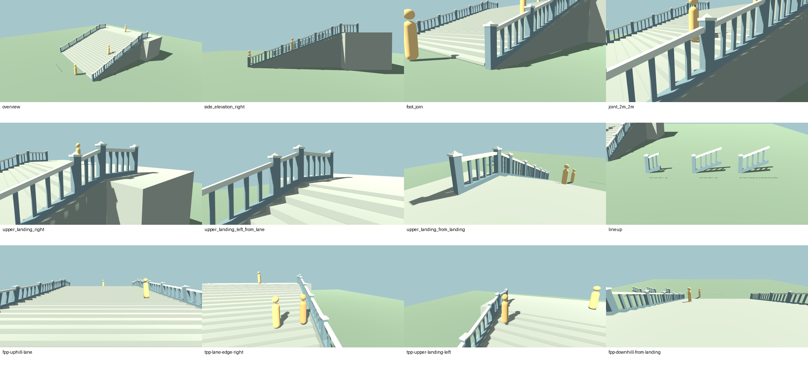
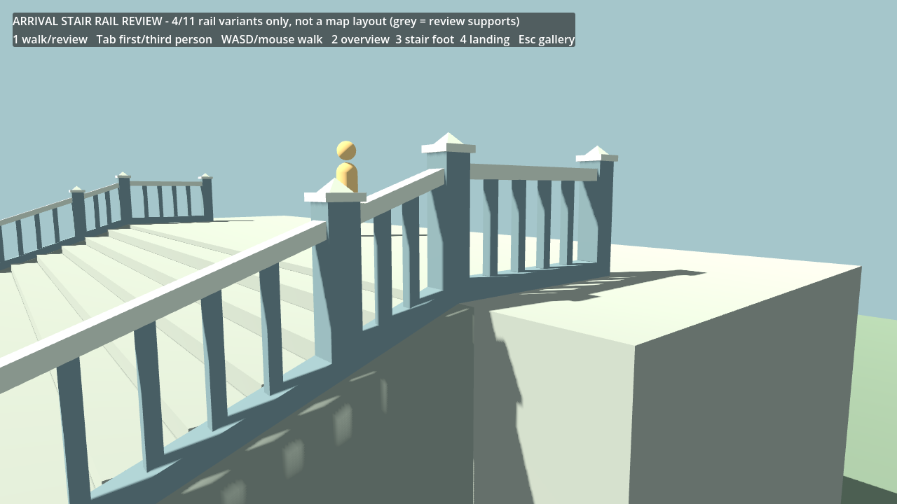
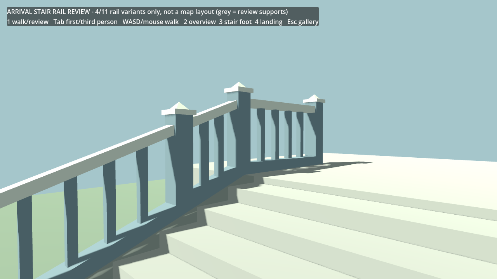
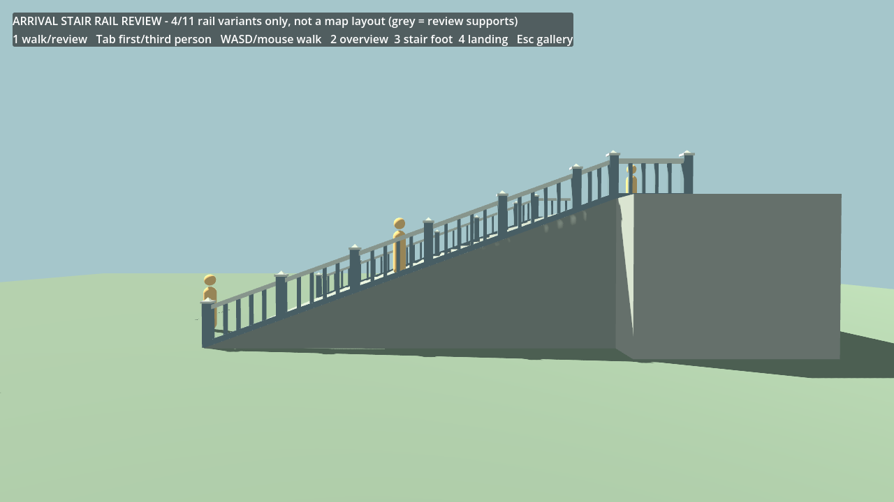
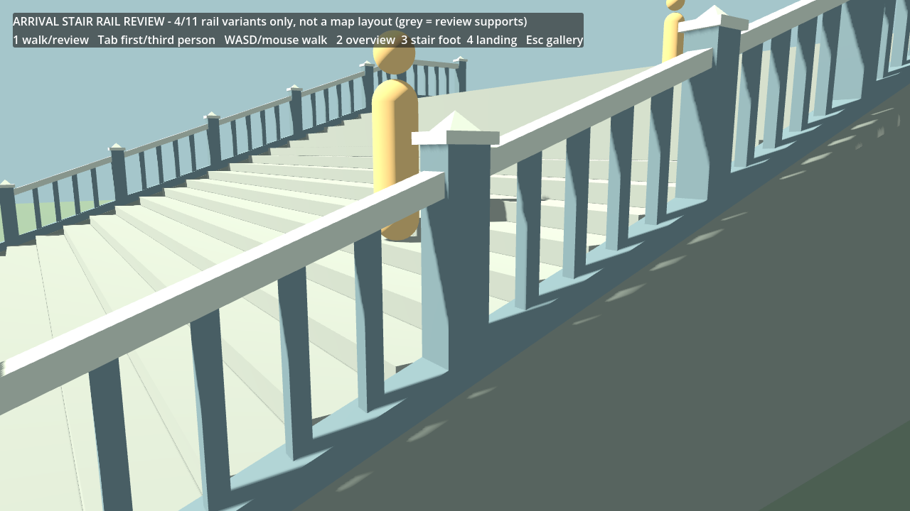

# Claude arrival-stair railing variants (4/11 pitch)

24 October 2026 · Claude · staging addition to the environment safety kit, ready for visual review. **Not placed in the map.** Phase 4C is not approved and Phase 4D has not been started.

There are two new stair-guardrail modules at the arrival stair's exact pitch: **rise/run = 4/11, 19.983106522°**. Both are built with the kit's existing guardrail profile. No existing model, scene or source was changed.



| Upper landing, outside | Upper landing, from the lane | Side elevation | 2 m / 2 m joint |
| --- | --- | --- | --- |
|  |  |  |  |

## Deliverables

All new files are under `staging/claude_environment_safety_kit/`.

| What | Path |
| --- | --- |
| 1 m module | `railings/rail_stair_4in11_1m.glb` + `.tscn` (root `RailStair4in11_1m`) |
| 2 m module | `railings/rail_stair_4in11_2m.glb` + `.tscn` (root `RailStair4in11_2m`) |
| Editable source | `source/claude_arrival_stair_rails.blend`: one collection per module at the authoring origin. It is separate from `claude_environment_safety_kit.blend`. |
| Builder | `tools/build_arrival_stair_rails.py` |
| Build summary | `arrival_stair_rails_summary.json`. It is separate from the kit's `build_summary.json`, which is unchanged. |
| Review scene | `review/arrival_stair_rails_review.tscn` (+ `.gd`) |
| Verifier | `review/verify_arrival_stair_rails.gd` |
| Evidence | `reports/claude-arrival-stair-rails/`: 12 captures, contact sheet, `verify-results.json`, `glb-audit.json` and logs |

The name says `4in11` rather than `20deg`, because the slope is exactly 4/11 and not a round angle.

## Connection dimensions

Both modules follow the kit's existing stair-rail conventions:
- **Axes:** local +X runs uphill, Y is up, and the centreline is z = 0.
- **Leading post:** each module includes its own leading post, centred at the origin on the pitch line.
- **Span end:** the span stops at the next post's face, so posts are never doubled.

| | `rail_stair_4in11_1m` | `rail_stair_4in11_2m` |
| --- | --- | --- |
| Next post origin (run, rise) | (1.000, **0.363636364**) | (2.000, **0.727272727**) |
| Span (plinth and top rail) | x 0.12 → 0.88 | x 0.12 → 1.88 |
| Top rail top at leading / far post face | 1.143636 / 1.420000 m | 1.143636 / 1.783636 m |
| Balusters (vertical, 0.09 m square) | 2 | 4 |
| Bounds W × H × D | 1.03 × 1.47 × 0.30 m | 2.03 × 1.83 × 0.30 m |
| Triangles / GLB | 78 / 6.3 KB | 102 / 7.6 KB |

**Profile (identical to the 22° and 24° modules):**

Heights are measured from the pitch line:
- **Post:** 0.24 m square stone post from −0.05 to 1.18 m, with a 0.30 m coping cap to 1.24 m and a pyramid tip to 1.34 m.
- **Plinth:** −0.05 to +0.16 m, 0.24 m deep.
- **Top rail:** +0.98 to **+1.10 m**, 0.18 m wide.
- **Balusters:** +0.14 to +1.00 m.

Materials are Stone (#667e88) and Coping (#bcc6bd), embedded, opaque, flat-shaded and untextured.

**Collision (same approach as the kit):**
- **Post:** a 0.24 × 1.29 × 0.24 box.
- **Rail:** an 8-point convex slab from x = 0.12 to L−0.12, from pitch −0.05 to pitch +1.10, ±0.12 deep.
- **Body:** a StaticBody3D in group `solid_world` (layer 1, mask 2).

**Arrival flight assembly (as in the review):**
- **Sections:** use 2, 2, 2, 2, 2 then 1 m, giving origins at run 0, 2, 4, 6, 8 and 10 and rise 0, 0.727273, 1.454545, 2.181818, 2.909091 and 3.636364.
- **Top post:** at run 11, rise 4.000000. It is the leading post of the first level landing section (`rail_section_2m`), or a standalone `rail_post`; the two are the same geometry.
- **Foot terminal:** the first section's own leading post.
- **Orientation:** posts and balusters stay vertical. Placement is yaw-only at unit scale.

**Integration note for Codex (nothing done):** Phase 4C's `safety_assembly.gd` builds stair-rail paths as `rail_stair_%ddeg_%dm`. The arrival stair would need `rail_stair_4in11_%dm` instead.

## Generation method

```
blender --background --factory-startup --python staging/claude_environment_safety_kit/tools/build_arrival_stair_rails.py
```

- **Why a separate builder:** the kit builder `build_safety_kit.py` is frozen; running it rebuilds and rewrites the whole kit. The new builder writes only the six files listed in its docstring.
- **What it copies:** the guardrail functions (`rail_post_at`, `rail_span`), geometry helpers, material values, glTF export settings and scene writer, all unchanged.
- **The only new input:** `SLOPE = 4/11`, instead of `tan(integer degrees)`.
- **Determinism:** a rebuild reproduced both GLBs, both scenes and the summary byte for byte. The `.blend` differed in about 4.5 KB of Blender's internal file bookkeeping, not in the geometry.

## Checks actually performed

These ran on a scratch copy of the project (`project.godot`, `addons`, `scripts`, `scenes` and this kit folder), so the real project's import cache was untouched. Engines: Godot 4.7.2 Compatibility; Blender 5.2.2 LTS.

| Check | Result |
| --- | --- |
| GLB audit (the kit's `tools/audit_kit_glb.py`): palette, opaque, no textures, flat normals, no degenerate faces | 2 / 2 new modules PASS. `rail_stair_22deg_2m` was audited alongside as a reference (`glb-audit.json`). |
| Exact values in the GLBs (float32 position accessors) | Top rail far end y = 1.4200000 (1 m) and 1.7836363 (2 m); expected 1.4200000 and 1.7836364 |
| Godot import | no errors or warnings (`import.log`) |
| Verifier (`verify-results.json`, `verify.log`) | **34 checks, 0 failures**, no engine errors |
| Rendered review | 12 captures plus contact sheet, no errors. I inspected every capture. |
| Preservation | every pre-existing file outside engine caches byte-identical before and after (see below) |

**The 34 verifier checks**

*Modules, five checks each for 1 m and 2 m:*
- **Bounds:** they match the leading-post convention, with the rail ending at the next post face (error 0.0 mm).
- **Pitch:** measured from the imported top rail at 0.3636432 (1 m) and 0.3636405 (2 m), against 4/11 = 0.3636364. That puts the next post origin at 0.363643 / 0.727281 m.
- **Profile, thickness, triangles and materials:** identical to `rail_stair_22deg_1m` / `_2m`.
  - The post's vertices are identical.
  - Every span vertex beyond the post is identical once measured from the pitch line. Balusters are measured at their own centre, because they are vertical.
- **Uprightness:** every face is axis-aligned or lies along the 4/11 pitch, except the post's pyramid cap, so no post or baluster is tilted.
- **Collision:** the post box and body settings equal the reference module's. The slab points are within 0.36 mm of the exact 4/11 points.

*Assembly, per side:*
- **Sections:** five 2 m and one 1 m section, chained exactly at (+L, +L·4/11). Origin error is 0, and placement is yaw-only at unit scale.
- **Flight end:** at y = 4.000 on the landing rail's leading post. A rail_post closes the landing run. The landing surface was measured at 4.000, so the post base sits 0.05 m into it.

*Visible joins, per side, using the kit meshes only:*
- **Coverage:**
  - Rays every 1 cm.
  - Probes 1 mm either side of all 14 post faces.
  - Swept from the foot post, through the top post, to the landing's closing post.
- **Plinth face:** no gaps, depth range 0.0 mm.
- **Top-rail face:** no gaps. The only depth change is the expected 3 cm step where posts stand proud of the rail.
- **Top-rail upper surface:** straight along the pitch, then level on the landing, with a range of 0.0 mm.

*Walking lane and collision:*
- **Clear lane:** no collision of any kind in the lane between the rail faces: 12.46 m wide, 2.2 m high, along the flight and onto the landing.
- **Waist-height rays:** they hit the rail's own collision shapes at exactly ±6.23 m on both sides, at seven positions: mid-section, a post joint, the 1 m section, the top post and the landing.
- **Walking with the unchanged controller:**
  - It climbs the lane centre to the landing (y 4.0008).
  - It climbs both lane edges, 0.30 m from the rail face, with no stop, no drift and no avatar clipping.
  - It descends the centre to the foot.
- **Sideways exits:** stopped at 8 points (mid 2 m, post joint, mid 1 m and the landing, both sides). The player ends 0.28 m from the rail face, the capsule radius, without dropping.

Six of the 34 checks failed on the first run. All six came from three mistakes in the verifier, not the models:
- **Profile check:** it first sheared the balusters along the pitch. They are vertical, so they had to be measured at their centre.
- **Collision check:** it compared rounded coordinates against rounded coordinates at too tight a tolerance. Kit scenes store collision points to 4 significant digits. It now compares against the exact values, within 0.5 mm.
- **Join sweeps, right side:** in two sweeps, one ray fell exactly on the flush edge where the foot post meets the plinth and grazed through to the far face.
  - Samples now sit 5 mm off module boundaries, with extra ±1 mm probes at every joint.
  - With that change, both sides pass with zero gaps.

**Preservation:**
- **Before and after:** I took SHA-256 hashes of all 6,222 project files (excluding `.godot`) before starting and again at the end.
- **Result:** 0 changed, 0 missing.
- **Added files:** 29, all of them the deliverables and evidence listed above. The final snapshot was taken just before this preservation note was written.
- **Sidecars:** no `.import`/`.uid` sidecars appeared during the session. An open Godot editor will add them when it next scans the new GLBs and scripts.

## Limitations

- **Review status:** this is not production safety certification. There has been no human playtest or acceptance; the walking checks are automated.
- **Import precision:**
  - Godot imports compress vertex positions (about 0.03 mm here), which is why the measured pitch differs from 4/11 by at most 7 × 10⁻⁶ (0.0003°).
  - The GLBs themselves hold the exact float32 values.
  - Collision points use the kit's 4-significant-digit format, within 0.36 mm.
- **Review supports versus Phase 4C:**
  - **Review:** grey steps, cheeks, landing and a collision-only walking ramp are review-only. The rails' local pitch line sits on the cheek top, which equals the walking pitch line, so the top rail is exactly 1.10 m above the walking line.
  - **Phase 4C:** its strips lift rails 0.06 m (top rail 1.16 m above the walking line). That is a placement choice; the modules are unchanged either way.
- **Unguarded edges in the review:** the landing's outer edges beyond the rails are not guarded. They are only review supports.
- **Lineup labels:** they are small in the lineup capture. Left to right, the modules are 1 m, 2 m and the existing 22° 2 m.
- **Slope coverage:** only the 4/11 pitch is added. Other branch slopes in Phase 4C would need their own variants.
- **Not checked:** the map itself, LODs, navigation, performance and long-run camera behaviour.

## Review launch

Open the project in the Godot editor. On first scan it imports the two new GLBs. Then open `staging/claude_environment_safety_kit/review/arrival_stair_rails_review.tscn` and press **F6**.

| Key | Action |
| --- | --- |
| 1 | Toggle walking / review camera |
| Tab | First/third person |
| WASD / mouse | Walk |
| 2 | Overview |
| 3 | Stair foot |
| 4 | Landing |
| Esc | Gallery |

**Verifier:**

```
godot --headless --fixed-fps 60 --path . --script res://staging/claude_environment_safety_kit/review/verify_arrival_stair_rails.gd -- <out.json>
```

**Captures:**

```
godot --path . --rendering-driver opengl3 res://staging/claude_environment_safety_kit/review/arrival_stair_rails_review.tscn -- --capture=<dir>
```

**Stop point:** the variants are ready for review. They are not placed in the map, Phase 4C is not approved and Phase 4D has not been started.
