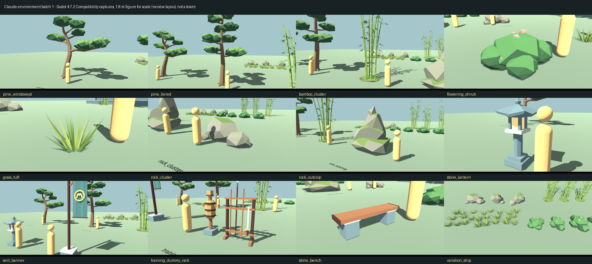

# Claude environment batch 1

23 October 2026 · Claude · staging delivery for review, not integrated

Eleven reusable environmental assets for the cultivation sect, in `staging/claude_environment_batch1/`. Each asset has an editable source, an exported GLB and a ready-to-instance Godot scene with gameplay collision. A review scene doubles as the contact-sheet generator.

Nothing outside that folder and this report's evidence folder was written. That means no permanent building, gallery entry, camera script, collision fix, terrain, town layout or original-project file. Batch 1 stops here, pending your review.

## What was delivered

| # | Asset | Folder / scene | W × H × D (m) | Triangles | Materials | Collision |
| --- | --- | --- | --- | --- | --- | --- |
| 1 | Windswept Pine | `pine_windswept/` | 7.49 × 6.87 × 3.96 | 1,306 | 3 | 2 convex trunk pieces, ground to 2.43 m |
| 2 | Tiered Mountain Pine | `pine_tiered/` | 5.21 × 8.79 × 4.49 | 1,500 | 3 | 1 convex trunk piece, ground to 2.21 m |
| 3 | Bamboo Cluster | `bamboo_cluster/` | 2.46 × 6.81 × 2.32 | 3,446 | 5 | 1 octagonal clump prism, radius 0.68 m, to 2.4 m |
| 4 | Flowering Shrub | `flowering_shrub/` | 2.02 × 1.03 × 1.79 | 330 | 3 | none (brush-through) |
| 5 | Grass Tuft | `grass_tuft/` | 1.21 × 0.72 × 1.22 | 72 | 2 | none (brush-through) |
| 6 | Path and Pond Boulders | `rock_cluster/` | 3.07 × 1.42 × 1.81 | 108 | 3 | 3 convex hulls, identical to the visible boulders |
| 7 | Stratified Rock Outcrop | `rock_outcrop/` | 3.37 × 3.60 × 2.65 | 164 | 3 | 4 convex hulls, identical to the visible ledges |
| 8 | Stone Lantern | `stone_lantern/` | 0.94 × 2.12 × 0.94 | 200 | 3 | 2 boxes (base and shaft, roof cap) |
| 9 | Sect Banner Standard | `sect_banner/` | 1.62 × 4.95 × 0.76 | 608 | 6 | octagonal pole plus socket box; banner cloth none (hem at 2.05 m) |
| 10 | Practice Dummy and Weapon Rack | `training_dummy_rack/` | 2.43 × 2.38 × 0.55 | 528 | 7 | dummy cylinder, arm bar box, rack box |
| 11 | Garden Bench | `stone_bench/` | 1.84 × 0.50 × 0.45 | 108 | 4 | 1 box |

All measurements come from the exported geometry. Width is X, height is Y and depth is Z. The eleven assets total 8,370 triangles and 608 KB of GLB.

Each asset folder holds `<id>.glb`, the model with embedded materials, and `<id>.tscn`, the model plus collision (**instance this one**). The `.glb.import` files were generated by the Godot editor you had open on the project; see section 7.

Shared files:
- **Editable source:** `source/claude_environment_batch1.blend`, one collection per asset at the authoring origin.
- **Builder:** `tools/build_environment_batch1.py`, the reproducible Blender generator.
- **GLB audit:** `tools/audit_env_glb.py`.
- **Review fixture:** `review/environment_batch1_review.tscn` + `.gd`.
- **Headless verifier:** `review/verify_environment_batch1.gd`.
- **Measured summary:** `build_summary.json`.

## 1. How the existing project set the targets

- **Scale.** Everything is sized against the project's only player, the 1.8 m inspection controller (`scripts/training_inspection_player.gd`: capsule 1.8 m × radius 0.28 m, visible avatar 0.40 m wide, eye at 1.65 m). It was verified in `CLAUDE_SCALE_AUDIT.md`.
  - Bench seat: 0.50 m.
  - Lantern: 2.12 m, taller than the Herb Garden's built-in lanterns (about 1.8 m), for paths and stairs.
  - Practice dummy: 1.94 m to its head, about a person.
  - Banner pole: 4.95 m.
  - Pines: 6.9–8.8 m, comparable to the Mission Hall ridge at 9.8 m.
- **Style rules followed** (`LOW_POLY_STYLE_GUIDE.md` and the earlier building builders):
  - flat-shaded faceted geometry
  - opaque materials, no textures, transparency, alpha cards, custom shaders, particles or glow
  - roughness 0.82 (bronze 0.56)
  - mild emission only on the lantern's fire box
  - units in metres, Godot axes with +Z as the front, origin on the ground
- **Polygon density.** It follows the existing props: Training equipment uses 100–2,820 triangles per item and Scripture furniture 124–2,984. Assets meant to be scattered in large numbers (grass, rocks, shrub) are kept the cheapest.
- **Palette.** I reused the Split-Cloud entries: Stone, Coping, Timber, Cedar, Bronze, Fabric, Lantern, Soil and Leaf. I added nature tones chosen to sit beside the jade roofs (#22594f) and blue-grey masonry without competing with them.

| New material | sRGB | Used on |
| --- | --- | --- |
| Bark | #6e5a48 | pine trunks and branches |
| PineNeedle / PineLight | #35573f / #5f8450 | needle pads (shaded / sunlit facets); shrub shade |
| Bamboo / BambooNode | #6d8c4a / #a3ac6e | culms and node bands |
| Grass / GrassLight | #5e7d43 / #8a9d5a | grass blades |
| Rock / RockLight / Moss | #646961 / #7d8177 / #5d7a45 | natural stone, upper facets, mossy tops |
| Blossom | #b8868a | sparse muted plum blossoms on the shrub |
| Straw | #a58c5a | practice dummy bindings |

Facet colours are chosen by face direction: upward faces get moss or sunlit needles. That gives readable form without textures and keeps it valid from any rotation.

**Relation to existing props.**
- **Training Ground:** it already has an arm dummy, sword rack, staff rack and rest bench. Asset 10 is a different courtyard set (straw-bound striking dummy plus a compact four-weapon rack), and asset 11 a stone-legged garden bench rather than the splayed timber bench. Neither replaces the Training Ground equipment.
- **Spirit Herb Garden:** its lanterns and cone plants stay inside that building's model, and nothing was changed there.

## 2. How the reference images were used

| Reference | Adopted | Not adopted, and why |
| --- | --- | --- |
| Cliff pavilion with twisted pines | Cloud-pad pine foliage on bent trunks (both pines); chunky faceted boulders with mossy tops (assets 6, 7) | Painted textures and fine needle tufts (no textures; too small for third person); hanging vines and fireflies (would need transparency or particles); the pavilion itself (no new buildings) |
| Night courtyard | Bamboo with pale node rings and drooping leaf sprays; tiered square stone lantern; tall grass tufts | Red paper lanterns and coloured night lighting (outside the restrained palette; lighting belongs to layout); ferns and pots (not in this batch's list); alpha-card leaves (closed solid leaves instead) |
| Low-poly island scene | Faceted, flat-shaded stone with grass-capped stepped ledges (outcrop); wooden posts; a muted blossom accent | Saturated pink blossom trees (reduced to a few muted blossoms); waterfalls, bridges, cone trees and the overall layout (not requested; the layout is deferred) |

**Where the project's constraints won:**
- **Foliage:** the pines are a little more geometric than the hand-painted reference, because all foliage is opaque closed geometry.
- **Lantern glow:** this is material emission only; no light node was added, matching the buildings.

## 3. Asset notes

The pivot of every asset sits on the ground under its main mass. Every asset can take any yaw.

1. **Windswept Pine (`pine_windswept`).** A "guest-greeting" pine with a leaning trunk, one long low arm and eight cloud pads, about 7.5 m across.
   - **Use:** gateways, terrace edges, cliff tops, beside halls.
   - **Clearance:** the lowest visible branch or foliage over walkable ground is 2.79 m.
   - **Collision:** the trunk only. The pads have none, so the third-person camera can pass into them (section 7).
   - **Placement:** the roots are sunk 0.14 m.
   - **Variation:** random yaw plus ±15% uniform scale works.
2. **Tiered Mountain Pine (`pine_tiered`).** A tall, upright pine with eight alternating tiers and a crown pad.
   - **Use:** background massing, avenues, mountain slopes. Its silhouette differs from the windswept pine, so the two can mix without reading as copies.
   - **Clearance:** the lowest foliage over walkable ground is 3.06 m.
   - **Collision:** the trunk to 2.21 m.
3. **Bamboo Cluster (`bamboo_cluster`).** Nine culms, 4.2–7.2 m tall, leaning out from a mossy soil mound, with pale node bands and drooping leaf sprays.
   - **Use:** groves (tile several with random yaw), path edges, behind walls.
   - **Clearance:** leaves over walkable ground start at 2.78 m.
   - **Collision:** one clump prism, so the player cannot squeeze between culms. It is the densest asset at 3,446 triangles, so prefer MultiMesh for large groves (as the Training props already do).
4. **Flowering Shrub (`flowering_shrub`).** A rounded evergreen mound about 1 m tall with eleven muted plum blossoms.
   - **Use:** garden beds, path borders, under trees.
   - **Collision:** none by design; the player brushes through. Add a cylinder in the placing scene if it must act as a hedge.
5. **Grass Tuft (`grass_tuft`).** Twenty-four three-sided blades in two greens, up to 0.72 m.
   - **Use:** scatter along paths, under trees and at rock bases.
   - **Collision:** none.
   - **Cost:** at 72 triangles it is the main scatter asset. Disabling its shadow casting and setting a visibility range of 40–60 m is recommended at placement.
6. **Path and Pond Boulders (`rock_cluster`).** One mossy boulder (1.4 m) with two companions.
   - **Use:** path edges, pond banks (they can be partly submerged), stream beds.
   - **Placement:** sunk 0.15 m, so they sit into flat ground without gaps. On slopes, sink them further.
   - **Collision:** the hulls are exactly the visible shapes, so the player stands on, or slides off, what they see.
7. **Stratified Rock Outcrop (`rock_outcrop`).** Four nested stone columns stepping up to 3.4 m, with mossy ledge tops.
   - **Use:** cliff edges, pond banks, a scholar's-rock focal point. Scale it 0.8–1.5× and combine pieces for longer cliffs.
   - **Placement:** sunk 0.2 m.
   - **Collision:** exactly the visible shapes. In the walk test from four sides, the player was blocked and did not climb it.
8. **Stone Lantern (`stone_lantern`).** A tiered square lantern on an octagonal shaft, with a glowing fire box between corner posts and an upswept hip-roof cap.
   - **Use:** paths, stairs, courtyards, in pairs at entrances.
   - **Collision:** boxes follow the base and the wider roof cap, so the body cannot clip the cap.
9. **Sect Banner Standard (`sect_banner`).** A stone socket, a timber pole with a bronze finial, a braced cross arm and a teal banner (0.8 × 1.9 m) with the Split-Cloud emblem on both faces.
   - **Use:** gates, courtyards, training grounds, approaches.
   - **Orientation:** the banner hangs toward +X.
   - **Collision:** the hem at 2.05 m clears the player's head, so the cloth needs no collision. The pole and socket collide. There is no text, so repeated banners don't show mirrored writing.
10. **Practice Dummy and Weapon Rack (`training_dummy_rack`).** A straw-bound striking dummy with arm bar (left) and a compact rack holding two staves, a spear and a sword (right). The gap between them is about 0.3 m visually and 0.27 m between collision shapes, too narrow to walk through.
    - **Use:** disciples' courtyards, residence yards, beside the Training Ground.
    - **Orientation:** the front faces +Z.
    - **Collision:** three shapes. Don't scale it; the dummy is person-sized.
11. **Garden Bench (`stone_bench`).** A thick cedar seat on two stone block legs; seat height 0.50 m.
    - **Use:** under trees, along paths, in courtyards.
    - **Collision:** one box. Keep scale 1.0 so the seat height stays right for a future sitting interaction.

## 4. Import and use

1. **Instance the `.tscn`, not the raw `.glb`.** The scenes carry the collision (a `StaticBody3D` in group `solid_world`, layer 1, mask 2, the same convention as the buildings). The GLB on its own has none.
2. **Placement:** put the root on the terrain surface. Rocks and trees are already sunk into flat ground. Rotate about Y freely.
   - Vegetation and rocks: uniform scale 0.85–1.15.
   - Lantern, banner, dummy/rack and bench: keep scale 1.0.
3. **Scatter:** for large numbers of grass, shrubs or bamboo, build `MultiMeshInstance3D` batches from the GLB meshes, and place collision separately where needed. This is the pattern `martial_training_ground.gd` and `scripture_pavilion.gd` already use.
4. **Paths:** every scene references its GLB by `res://staging/claude_environment_batch1/...` path, with no UID. If Codex moves an asset to a permanent folder, update that one path in the `.tscn`, or regenerate it from the builder with a new `RES`.
5. **No texture dependencies.** All materials are embedded in each GLB, and no image or external file is referenced.
6. **Editing:**
   - **Preferred:** change `tools/build_environment_batch1.py` and run `blender --background --factory-startup --python tools/build_environment_batch1.py`. It regenerates the `.blend`, GLBs, scenes and summary; I confirmed a rebuild is byte-identical.
   - **Hand edits:** you can edit meshes in the `.blend` (hide the other collections) and re-export, but then update the `.tscn` collision by hand. The next builder run overwrites hand edits.
7. **Review:** open `res://staging/claude_environment_batch1/review/environment_batch1_review.tscn` and press Run Current Scene.
   - **Keys:** 1 walks/reviews, Tab switches first/third person, WASD/mouse to move, 2–4 for views, Esc returns to the gallery.
   - **Layout:** two inspection rows with 1.8 m figures, a rotation/scale variation strip, and a vignette around a read-only instance of the existing Mission Hall.
   - This is review spacing, not a town layout. The assets are not in the gallery catalog.

## 5. Verification actually performed

**Where it ran:**
- Godot 4.7.2 Compatibility renderer, RTX 3050 Laptop, on a scratch copy of the project containing this folder, so my test runs could not touch the real project's import cache.
- Blender 5.2.2 LTS for the build.

| Check | Result | Evidence in `reports/claude-environment-batch1/` |
| --- | --- | --- |
| GLB audit: exact palette, roughness, opaque, no images/textures/external URIs, finite positions, unit normals, flat triangles, no zero-area triangles | 11 / 11 PASS | `glb-audit.json` |
| Godot import of all GLBs | completed, no errors or warnings | `import.log` |
| Headless verifier with the unchanged controller | **76 checks, 0 failures**, no engine errors or warnings | `verify-results.json`, `verify.log` |
| Rendered review captures | 19 screenshots plus a contact-sheet grid, no errors | `*.png`, `capture.log` |
| Deterministic rebuild | rebuild reproduced every GLB, `.tscn` and summary byte-for-byte | (run log only) |

The 76 checks covered:
- **Every asset:** it imports and instances (triangles, materials, size), its pivot is on the ground (lowest point −0.20 to 0.00 m), and its pivot lies inside its footprint.
- **Collision policy:** solid assets have collision; shrub and grass have none.
- **No invisible walls:** collision stays inside the visible bounds.
- **Walk test from four sides:**
  - The shrub and grass let the body reach the pivot (closest approach 0.00–0.02 m).
  - Every solid asset kept the body off it: closest approach 0.34–2.06 m, and the player never ended on top.
- **Standing against each solid asset**, on 21–61 spots per asset, visible geometry never entered the visible avatar's upper body (0.9–1.8 m, radius 0.20).
- **Trees and bamboo:** the lowest foliage or branch over walkable ground is 2.78–3.06 m.

I inspected the captures myself. Review rounds 1–2 produced these fixes:
- rocks were too pale (white tops) → darker neutral stone, more facets
- the outcrop read as a stacked cairn → nested ground-to-ledge columns
- pine pads were thin plates from below → thicker five-blob cushions
- lantern corner "horns" → upswept hip-roof cap, less white coping
- the shrub was lime and crystal-like → evergreen tones, rounder hulls, larger blossoms

## 6. Limitations

- **Visual judgment.** No human visual review or acceptance yet; colours were judged only under the review fixture's sun and ambient light. Some contact-sheet close-ups have a 1.8 m figure partly in frame (kept for scale).
- **Camera through foliage.** It was not tested. Pine pads, bamboo tops, shrub, grass and banner cloth have no collision, so the third-person camera can pass through them. Add camera-only shapes at placement if that bothers you in play.
- **Lower-body clipping.** The legs against low parts such as pine roots and the shrub were not checked; the body test covered 0.9–1.8 m only. The grass and shrub are brush-through by design.
- **Not done:**
  - LODs
  - wind or other animation
  - seasonal or colour variants
  - text on the banner
  - lights
  - navigation mesh
  - terrain or slope fit (rocks and trees are sunk for flat ground only)
  - placement in the town
  - gallery catalog entries
- **Performance.** Not measured. The batch total is 8,370 triangles, and nothing was profiled in a populated scene.
- **Rock climbing.** Whether the player can climb the rocks depends on slope at placement. On flat ground the walk tests found no climbing, but steeper terrain changes that.
- **Review fixture dependency.** The review scene loads the Mission Hall scene read-only for comparison. If that scene moves, the vignette will fail to load; the assets themselves will not be affected.

## 7. Side effects in the real project

A file snapshot of the test project and `asset-workshop` was taken before this task started and compared at the end. There are 69 new files in this folder, this report and `reports/claude-environment-batch1/`. I wrote 56 of them; the other 13 are the editor sidecars described below. Every other difference came from two processes running alongside me, not from my commands. All my Godot runs used the scratch copy, and the Blender build wrote only into this folder.

- **Your Godot editor**, opened at 23:00:16 (`OneDrive/Desktop/Godot.exe --editor`) and running the asset gallery. It auto-imported this new folder, as it does for any added file.
  - It created the eleven `.glb.import` and two `.gd.uid` files in this folder.
  - It wrote 22 import cache files under `.godot/imported/` and per-asset folding files under `.godot/editor/`.
  - It updated `uid_cache.bin`, `global_script_class_cache.cfg`, `scene_groups_cache.cfg` and its layout and cache files.
  - It rewrote `project.godot` at 23:00:22. The file has the same size as before (925 bytes), but I had no pre-task content hash, so byte identity is not proven.

  I kept the editor's sidecars rather than overwrite them with my scratch-copy versions, so its UID cache stays consistent. The shrub GLB changed after that import (its final geometry was built at 23:03), so the open editor will reimport it on its next rescan.
- **Codex**, finishing its Main Hall rear-column collision alignment. It updated `HANDOFF.md` at 22:58 and reorganised files in `reports/main-hall-collision-fix/`.

The original `asset-workshop` project's 3,022 files were unchanged: path, size and modification time are identical.

## 8. Next step

Batch 1 stops here for your review. Open the review scene and walk it in both camera modes. Then decide:
- whether the pine, bamboo and shrub colours suit the jade roofs
- whether the blossom accent stays
- whether the bamboo should get collision per culm rather than one clump
- whether the trees need camera-only canopy shapes

After acceptance, Codex can integrate the chosen assets into permanent folders and the gallery. I have not started a second batch.
