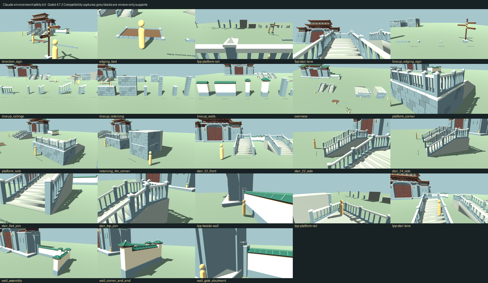
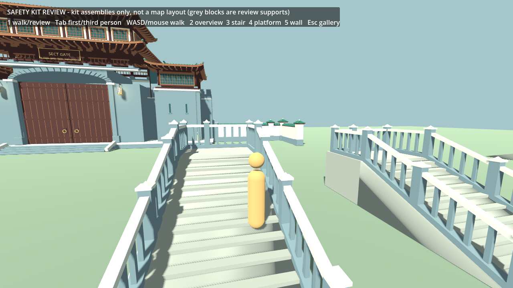
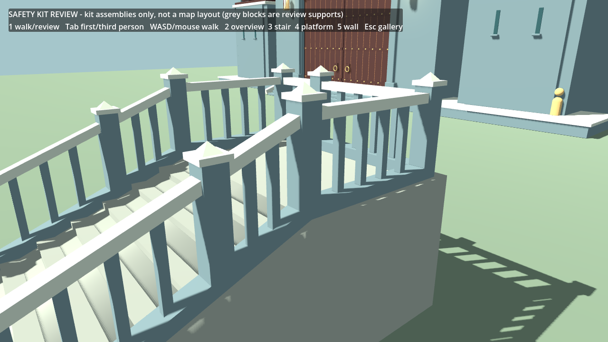
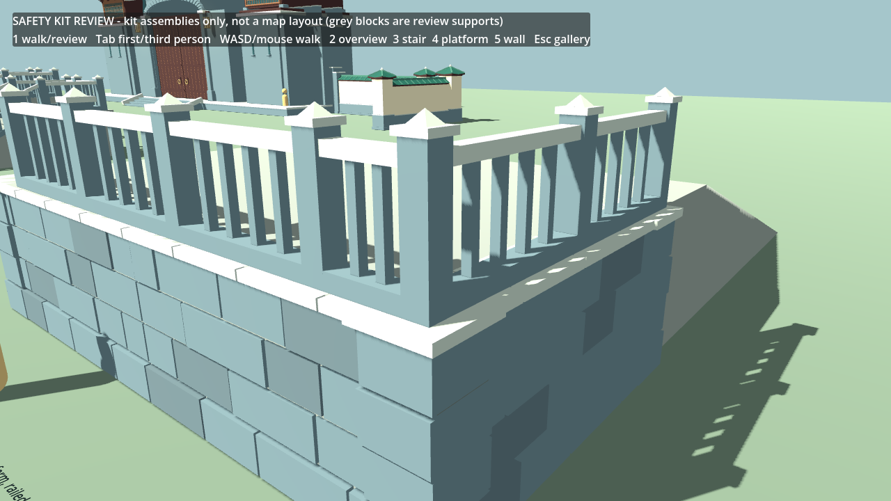
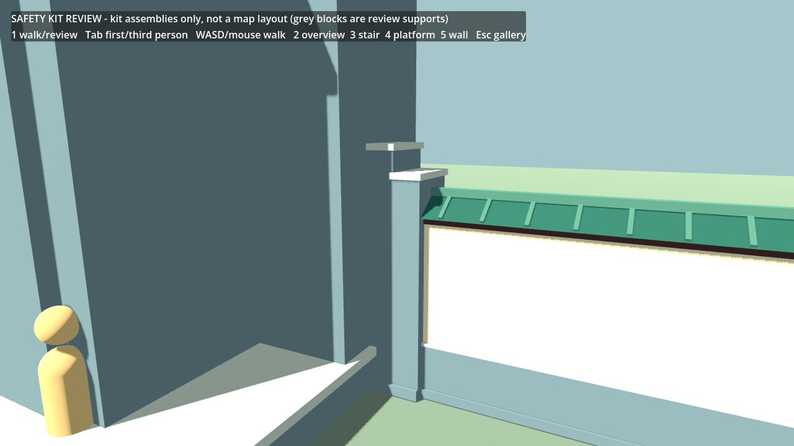

# Claude environment safety kit

24 October 2026 · Claude · staging delivery for visual review. Not placed in the map and not integrated.

A compact architectural support kit with five families and 22 placeable scenes:
- boundary walls
- terrace and stair guardrails
- retaining walls
- low edging
- a direction sign.

It lives in `staging/claude_environment_safety_kit/`. Nothing was added to the mountain-valley scene, galleries, buildings, environmental assets, Phase 4A, player/camera code or the original project.

| Stair lane, third person | Slope-to-flat join at the landing | Railed retaining corner | Wall abutting the Sect Gate |
| --- | --- | --- | --- |
|  |  |  |  |

## Inventory

Sizes are measured from the exported geometry: W is X (the run), H is Y and D is Z. All 22 scenes have identity roots, metre units and origins on the ground. The kit totals 2,842 triangles, counting each part once, and 248 KB of GLB.

| Scene (`staging/claude_environment_safety_kit/...`) | W × H × D (m) | Triangles | Collision |
| --- | --- | --- | --- |
| `walls/wall_section_2m` | 2.00 × 2.70 × 0.76 | 176 | body box ±0.33 m to 2.36 m + cap box ±0.38 m |
| `walls/wall_section_4m` | 4.00 × 2.70 × 0.76 | 272 | as above |
| `walls/wall_pier` (support / end post) | 1.14 × 3.31 × 1.14 | 172 | body + cap boxes |
| `walls/wall_corner` (90° corner pier) | 1.34 × 3.46 × 1.34 | 172 | body + cap boxes |
| `walls/wall_gate_end` (gate abutment) | 0.84 × 3.24 × 0.90 | 60 | 2 boxes |
| `railings/rail_section_1m` / `_2m` | 1.03 / 2.03 × 1.39 × 0.30 | 78 / 102 | leading post box + rail slab (0.24 m deep) |
| `railings/rail_post` (end / corner post) | 0.30 × 1.39 × 0.30 | 30 | 1 box |
| `railings/rail_stair_22deg_1m` / `_2m` | 1.03 / 2.03 × 1.51 / 1.91 × 0.30 | 78 / 102 | post box + sloped convex slab |
| `railings/rail_stair_24deg_1m` / `_2m` | 1.03 / 2.03 × 1.54 / 1.99 × 0.30 | 78 / 102 | post box + sloped convex slab |
| `retaining/retaining_wall_4x2` / `_4x4` | 4.00 × 2.00 / 4.00 × 0.68 | 276 / 504 | 1 box |
| `retaining/retaining_corner_2` / `_4` | 0.80 × 2.00 / 4.00 × 0.80 | 72 / 120 | 1 box |
| `retaining/retaining_end_2` / `_4` | 0.80 × 2.00 / 4.00 × 0.80 | 72 / 120 | 1 box |
| `edging/edging_2m` | 1.98 × 0.18 × 0.18 | 48 | none (decorative) |
| `edging/edging_corner` / `edging_end` | 0.26 × 0.23 × 0.26 / 0.22 × 0.25 × 0.22 | 24 / 18 | none |
| `sign/direction_sign` (post + 3 boards) | 3.14 m tall; boards reach 1.30 m from the post | 326 | post cylinder + base box; boards none (above head height) |

Materials are the Split-Cloud building palette, embedded in each GLB: Stone, Coping, Timber, Cedar, Plaster, Jade, TileLight and Bronze. The Rock joint tone comes from environment batch 1. One new accent, StoneShade (#5b6f78), is used for occasional retaining stones. Everything is flat-shaded and opaque, with no textures or external files.

## Connection conventions

**Boundary wall.** Sections run from local x = 0 to x = 2 or 4 on centreline z = 0.
- **Straight runs:** sections chain flush with no post: the next origin is the previous one plus L. The stone base, plaster and tile cap continue seamlessly.
- **Piers:** a `wall_pier` centred on any joint is optional on straight runs and required at free ends.
- **Corners:** put a `wall_corner` at the corner point and start the next run there, rotated ±90° about Y.
- **Why piers and corners hide the joins:** both are wider than the wall (piers ±0.57 m, corners ±0.67 m, against ±0.38 m) and their eaves sit above the wall ridge, so overlapping caps stay inside them.
- **Height:** 2.70 m to the ridge (piers 3.31 m, corners 3.46 m), checked against the 1.8 m player and the buildings' plaster walls.
- **Gate termination (`wall_gate_end`):** its local x = 0 is the gate tower face, and it embeds 0.08 m into that face. Place it on the Sect Gate's documented connector, gate-local (±15.4, 0, 0). On the right side the wall continues toward +X from local x = 0.70; for the left connector, rotate it 180°. It is a stepped stone abutment from 3.24 m down to 2.90 m, not a gatehouse.

**Guardrail.**
- **Sections:** each section contains its leading post, centred at x = 0, and its rail span up to the next post's face. The next section starts at x = L, so posts are never doubled. Close a run's final end, and any corner, with a standalone `rail_post` or the next section's leading post.
- **Corners:** rotate the next section 90° about the shared post.
- **Placement:** the centreline is z = 0 and the plinth is 0.24 m deep, so put the centreline at least 0.12 m outside the walking-lane edge.
- **On a 2 m retaining wall:** the centreline sits 0.18 m behind the face, which puts the plinth on the coping.
- **Height and openings:** the top rail is 1.10 m above the local walking surface, posts are 1.34 m, and the openings between balusters are 0.19–0.28 m wide. The player is 0.56 m wide.

**Stair guardrail: supported angles and assembly.**
- **No stretching:** each stair section is built at its true slope. Its plinth and top rail are parallel to the pitch line, with the top rail 1.10 m above it; posts and balusters are vertical.
- **Assembly:**
  1. Put the first section's origin, its leading post, at the foot, on the pitch line.
  2. Turn it so local +X points uphill.
  3. Chain each next section at (+L along the run, +L·tan θ up).
  4. The top post is the first flat landing section's leading post, or a `rail_post`.
- **Angles:**
  - The 22° modules serve 21–23° stairs, and the 24° modules serve 23–25°. At ±1° the far end of a 2 m section is off by at most 4 cm.
  - That fits the map's arrival stair (22.8°), living stair (21.8°) and grand stair (24.0°).
  - The cloud stair (20.6°) would be about 5 cm off per 2 m with the 22° module. For that, add one line, `rail_stair(L, 21)`, to the builder and rebuild.
- **Footing:** stair rails need a sloped cheek, stringer or ground along the pitch line underneath them. The review stairs use stone cheeks just outside the lane, matching the Hall's stair rails.

**Retaining wall.**
- **Orientation:** the face plane is z = 0, facing +Z toward the lower ground. The body runs to z = −0.6 into the terrace; the section spans x = 0 to 4; the coping top sits at the terrace level (y = 2 or 4).
- **Chaining:** sections chain flush. Coursed stones use an irregular bond, so joins read as normal mortar joints.
- **Outer corners:** place `retaining_corner_*` at the end point of the run that arrives at the corner, in that run's orientation. Then start the next run there, rotated +90°.
- **Ends:** `retaining_end_*` is centred on a run's start or end point.
- **Taller walls:** use the separate 4 m modules, which carry a string course at mid-height. Inner (concave) corners are not provided.

**Edging.**
- **Height:** 0.14 m, well below the 1.10 m guardrail.
- **Layout:** sections run from x = 0 to 2. Corner stones are centred at corner points and end stones at run ends; both are slightly taller, so they cover the overlap.
- **Collision:** none, by design. The player walks over it, and the shoe-level overlap is only 0.14 m, so it never snags. Use guardrails wherever a barrier is intended.

**Direction sign.**
- **Structure:** `sign/direction_sign.tscn` is a post plus three nodes, `Board1`–`Board3`. Each holds an arrow board model and `LabelFront`/`LabelBack` Label3D text.
- **Changing it:** edit the label `text` to change destinations, rotate a `Board*` node about Y to re-aim it, or delete a board. For per-instance edits, enable Editable Children.
- **Demo labels:** MAIN HALL, TRAINING GROUND and LIVING DISTRICT (existing destinations only).
- **Height:** the lowest board's underside is at 1.84 m, above the 1.80 m player.

## Paths and review launch

- **Editable source:** `source/claude_environment_safety_kit.blend`, one collection per module at the authoring origin.
- **Builder:** `tools/build_safety_kit.py`. Run `blender --background --factory-startup --python tools/build_safety_kit.py`; it regenerates the source, GLBs, scenes and `build_summary.json`. A rebuild was confirmed byte-identical.
- **Exports:** the `<family>/<module>.glb` beside each `<module>.tscn`. Scenes reference GLBs by `res://` path without UIDs.
- **GLB audit:** `tools/audit_kit_glb.py`. It runs my frozen Exchange Hall audit against this palette and writes no files into that folder.
- **Review scene:** `review/safety_kit_review.tscn`. Open the project in the Godot editor, which imports the new kit files on first scan, open the scene, then press **F6**.
  - **Keys:** 1 walks/reviews, Tab switches first/third person, WASD/mouse to move, 2 overview, 3 stair, 4 platform, 5 wall, Esc returns to the gallery.
  - **Layout:** wall assembly from the real Sect Gate's connector, a 22° stair and a 24° stair with railed landings, a 2 m railed retaining platform with a corner, a 4 m retaining corner, an edging bed and open run, the sign, 1.8 m figures and a lineup of all 22 modules.
  - **Supports:** grey blocks are review-only. The Sect Gate is a read-only instance.
- **Verifier:** `review/verify_safety_kit.gd`.

## Checks actually performed

These ran on a scratch copy of the current project, including the current controller with Codex's indoor-camera change, so the real project's import cache was untouched. Engine: Godot 4.7.2 Compatibility; Blender 5.2.2 LTS for the build. Evidence is in `reports/claude-environment-safety-kit/`.

| Check | Result |
| --- | --- |
| GLB audit (palette, opaque, no textures, flat normals, no degenerate or non-finite data) | 23 / 23 PASS (`glb-audit.json`) |
| Godot import | completed with no errors or warnings (`import.log`) |
| Verifier (`verify-results.json`, `verify.log`) | **37 checks, 0 failures**; no engine errors |
| Rendered review | 23 captures plus contact sheet, no errors; inspected by me (`capture.log`, `*.png`) |
| Builder determinism | rebuild byte-identical |
| Preservation | all 7,519 pre-existing files (excluding engine caches) byte-identical before and after |

The 37 verifier checks:
- **Module bounds:** 13 modules match their documented connection points within 2 mm. The four stair sections end at the next post face with the top rail exactly 1.10 m above the pitch line.
- **Joins:** eight ray sweeps every 2 cm found no gaps and aligned faces across every join:
  - wall dado, plaster and cap across section joints (depth variation 0)
  - guardrail plinth across posts and top rail (0)
  - 22° stair top rail along the slope (0)
  - retaining face across the module joint (0 holes; 7 cm variation = mortar recesses)
- **Walking with the unchanged controller:**
  - beside the wall past joints and the pier: 8.8 m with no stop and no visible clipping
  - the wall blocks at mid-section and at a joint
  - the 22° stair lane is climbed at its centre and along its edge, 0.30 m from the rail, reaching the landing at 2.02 m with no drift and no clipping
  - the stair rail stops sideways exits at two points
  - the platform rail and its corner hold the player on a 2 m terrace
  - the open edging is crossed without a snag
  - walking past the sign, the boards stay above the avatar
- **Views:** first- and third-person captures show no visible assembly faults: no gaps, doubled posts, overlapping caps or stretched rails.

## Limitations

- **Review status:** this is not production safety certification. There has been no human playtest or acceptance.
- **Discrete stair angles:** only 22° and 24° are built. Other slopes need a one-line builder addition.
- **Not provided:** inner (concave) corners for walls and retaining walls, curved runs, battered (inward-sloping) retaining faces and terrain-following bases. Modules assume level ground along each section; stair rails assume a straight pitch line.
- **Retaining walls:** these are wall faces only. Map terraces still need their own ground, and the kit does not rebuild cliffs or terraces.
- **Edging:** it has no collision.
- **Sign:** the boards have no collision, so the third-person camera can pass through them. Label3D uses the default font, so English text only.
- **Not done:** LODs, navigation mesh, performance profiling and camera behaviour along long wall runs (beyond the captures).
- **Map stairs:** the map's 12–16 m stairs are currently smooth ramps without cheeks. Rails placed there need a footing strip along the pitch line, and their lanes narrow by the rail depth.
- **Parallel work:** during this task another workstream created four files under `mountain_valley_compact/review/`. I did not touch them, and all pre-existing files matched.

## Suggested later uses (nothing placed)

- **Stairs:** 22° rails for the arrival and living stairs; 24° rails for the grand stair to the Hall; a 21° variant for the cloud stair.
- **Terraces:** railed retaining edges for the arrival court (+8 m), living terrace (+20 m), Hall forecourt (+48 m) and scholar ledge (+56 m).
- **Boundary wall:** run it from the Sect Gate's two connectors around the arrival court, with piers every 8–12 m. Keep the Hall's axis views open with low guardrails rather than tall walls.
- **Edging:** for garden beds and courtyard paths.
- **Signs:** one at the cloud-stair landing junction, pointing to the existing districts.

**Stop point:** the kit is ready for visual review. No map integration, Phase 4B approval or new phase has been started.
