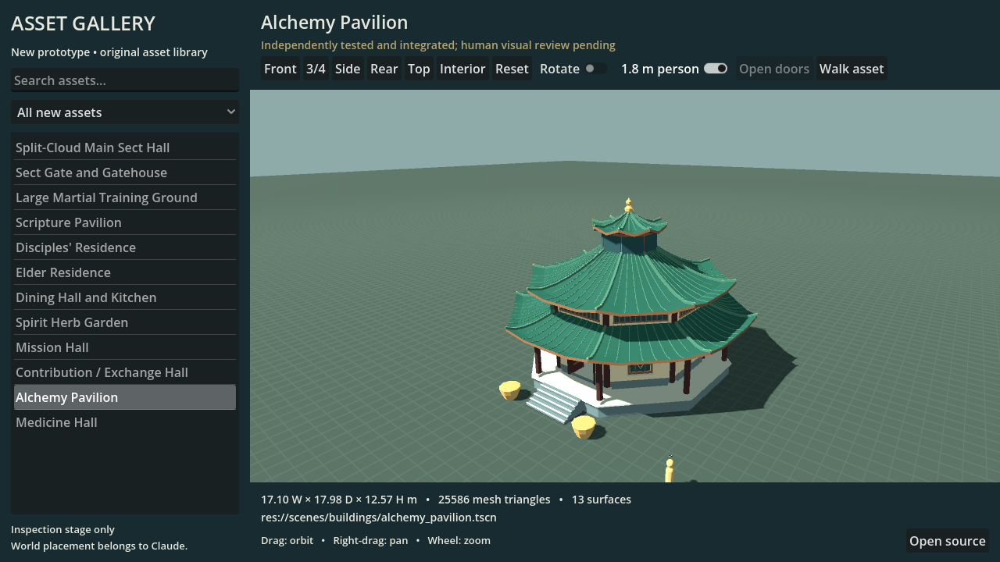
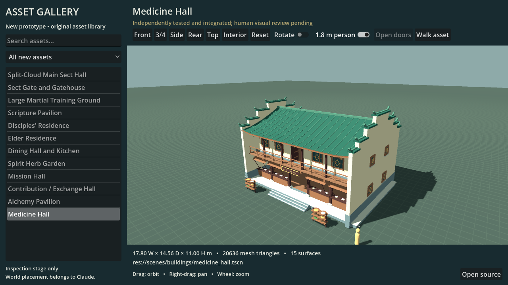
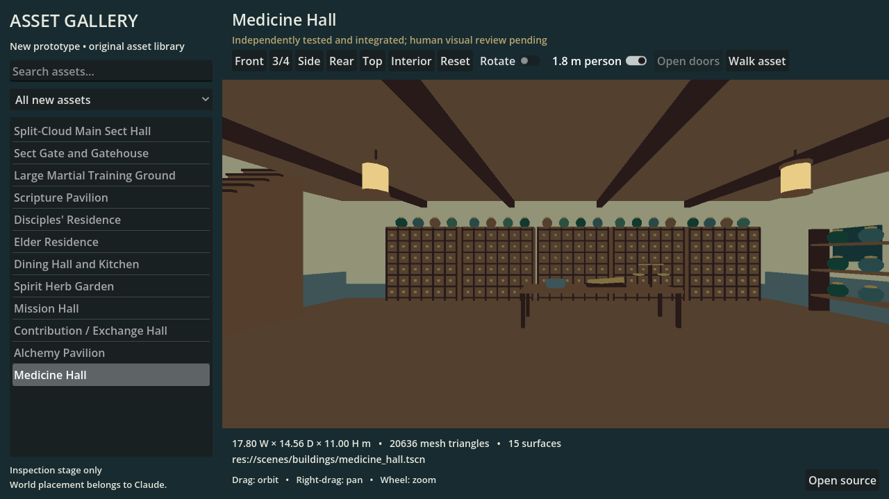

# Codex report — Alchemy Pavilion and Medicine Hall integration

23 October 2026, following the 22 October staged delivery. **Both existing assets are independently reviewed/tested, corrected and integrated as gallery entries eleven and twelve.** Models, materials and shared editable source remain identical to Claude's delivery. Only these candidate scenes and their new review fixture were corrected. No duplicate assets, town placement or production-project edits were made. Mission/Exchange work was preserved and not repeated.

Read the current CODEX report, handoff, Claude report, actual staging scenes/models/summary, builder, review/verifier and established gallery/player code. The earlier **21/21 is a combined suite**, comprising ten Alchemy and eleven Medicine assertions; it was not 21 checks per asset. Claude's report and original evidence remain untouched. Prior Mission/Exchange reports are archived at [previous-CODEX_REPORT.md](codex-alchemy-medicine/previous-CODEX_REPORT.md); their historical limits still apply.

## Permanent assets and measured scale

Paths below are relative to `prototype/CultivationSect_LowPoly_Test/`. Destinations were absent before copying (`codex-alchemy-medicine/destination-check.json`). Each GLB has freshly generated `.glb.import` metadata with a distinct UID from staging. Palette materials are embedded; no textures or separate material resources are required.

| Asset | Model | Building scene | Walkthrough |
| --- | --- | --- | --- |
| Alchemy Pavilion | `assets/architecture/alchemy_pavilion/alchemy_pavilion.glb` | `scenes/buildings/alchemy_pavilion.tscn` | `scenes/review/alchemy_pavilion_walkthrough.tscn` |
| Medicine Hall | `assets/architecture/medicine_hall/medicine_hall.glb` | `scenes/buildings/medicine_hall.tscn` | `scenes/review/medicine_hall_walkthrough.tscn` |

Shared Blender source: **`source/claude_batch2_integrated.blend`**, copied byte-for-byte from `staging/claude_buildings_batch2/source/claude_batch2.blend`. Two editable collections, `AlchemyPavilion` and `MedicineHall`, remain at the authoring origin; isolate the desired collection for editing. Shared standalone review: **`scripts/alchemy_medicine_review.gd`** (+ generated `.gd.uid`). Medicine additionally depends on **`assets/architecture/medicine_hall/medicine_camera_obstructions.tres`**, the collision-only resource described below. These resources have no runtime staging or original-project dependency.

Only existing runtime catalog `assets/gallery/catalog.json` changes: appends both entries with their correct Walk routes and interior presets, preserving the first ten entries and the unchanged gallery script. Select either new entry → **Walk asset**. Controls: 1 review/walk, WASD/mouse, Tab first/third person, 2 Alchemy, 3 Medicine, Esc gallery. Each asset is displayed individually at local identity on a neutral review plane; these are not world positions.

| Imported measurement | Alchemy Pavilion | Medicine Hall |
| --- | --- | --- |
| Width × depth × height | 17.0983 × 17.98391 × 12.57 m | 17.8 × 14.55696 × 11.00315 m |
| Floor elevations | .90 m | .45 m shop, 4.20 m loft/balcony |
| Mesh triangles / surfaces | 25,586 / 13 | 20,636 / 15 |
| Final collision shape count | 45 (43 originals + two leaf boxes) | 54 (53 authored, four counter boxes corrected, + one camera-only shape) |
| Main visible entrance width/headroom | 2.20 / 3.00 m at wall | 2.80 / 3.09 m at shop opening |
| Other measured clearance | Porch plaque headroom 2.67 m | Loft balcony door 1.60 m at wall, 2.40 m headroom |

Both origins sit at y=0, roots are identity, units are metres and entrances face +Z. Alchemy's new leaf boxes leave 2.0 m clear. Door/window props and thresholds were not scaled. All 13/15 palette materials are present, opaque and texture-free; exported geometry has finite positions, unit flat normals, correct palette/roughness, no external URIs and no near-zero-area triangles. Bronze roughness .56, Water .5, other palette surfaces .82.

## Tests actually executed

| Test | Actual result | Evidence under `reports/codex-alchemy-medicine/` |
| --- | --- | --- |
| Fresh combined Claude checks against staging | 21 PASS / 0 FAIL | `staged-basic/verify-results.json`, `staged-basic.log` |
| Combined checks against corrected canonical scenes | 21 PASS / 0 FAIL | `canonical-basic/verify-results.json`, `canonical-basic.log` |
| Expanded headless FPP/TPP | 124 PASS / 0 FAIL: Alchemy 61, Medicine 63 | `headless-results.json`, `headless.log` |
| Expanded rendered FPP/TPP | 136 PASS / 0 FAIL: Alchemy 66, Medicine 70 | `rendered-results.json`, `rendered.log` |
| Gallery / actual programmatic key and mouse events | 53 PASS / 0 FAIL | `gallery-input.json`, `gallery-input.log` |
| Read-only reopening of copied Blender source | 11 PASS / 0 FAIL (five per collection + shared metre convention) | `native-source.json` |
| Staged and copied GLB geometry/material audits | Both PASS | `staged-glb-audit.json`, `canonical-glb-audit.json` |
| Import/render compatibility | Both canonical models imported and rendered in Godot 4.7.2 | `import.log`, capture/runtime logs; host diagnostics below |
| Preservation/provenance | PASS: original project, staging, earlier ten assets/player/settings unchanged | `preservation.json`, `before-hashes.json` |

The unchanged 1.8 m tall, .28 m radius inspection controller traversed Alchemy's front stair/porch/door, front/east/rear/west furnace-room aisles and full outer colonnade circuit, with furnace/front-wall blocking. Medicine traversed front stair/central shop, west stair approach, interior stair up and down, loft landing/aisles, balcony door/three balcony positions, return to ground, counter and balcony-rail blocking. Each route set was exercised in both camera modes. The rendered suite includes twelve image-write assertions; counts are not numbers of distinct gameplay systems.

Each final expanded run sampled **416 Alchemy and 398 Medicine camera/body pairs** against authored solids and visible-mesh copies. Final sampled .16 m camera spheres and .24 m radius upper-body capsules have no intersections. Gallery tests loaded all twelve entries, checked both source paths/interior cameras/Walk wrappers, and exercised 1, W, Tab, mouse look, 2/3 review switching, velocity reset, live collision-exception lifecycle and Esc. Old Mission/Exchange movement suites were not rerun; no regression was found by gallery loads or preservation hashes.

## Failures found and corrections

1. **Medicine collision coverage:** initial expanded headless run was **123 PASS / 1 FAIL** (one aggregate clearance assertion, with counter body contacts and camera contacts on stair detail/hanging herbs). The serving counter collision was shallower than its overhanging timber top. Four existing boxes now match the top's width/depth and elevation, without changing visible geometry. Code/data: `tools/fix_medicine_collision.py`, `collision-corrections.json`, `before-medicine-collision-fix.*`.
2. **Medicine camera detail versus walking ramp:** adding hard-step collision to the walking body would interfere with the working ramp. A separate static body instead carries **one concave shape with 698 actual model triangles**: 538 stair-detail triangles and 160 hanging-herb triangles. This protects camera sweeps while preserving smooth walking. Build tool: `tools/build_medicine_camera_shape.gd`; output `medicine_camera_obstructions.tres`; evidence `camera-shape.json`. No rendered mesh was added or changed.
3. **Alchemy static door leaves:** the first rendered run after the Medicine correction was **135 PASS / 1 FAIL**, detecting an additional third-person camera safety-sphere contact with an uncollidable open leaf. Two boxes now match the static leaves and their crossbars. Source/model/poses are unchanged; all 43 original shapes retained. Code/evidence: `tools/fix_alchemy_leaf_collision.py`, `alchemy-leaf-correction.json`, `before-alchemy-leaf-fix.*`. The same camera probe passes the final reruns; its tolerance was not relaxed.
4. **New review-fixture lifecycle:** initial gallery assertions returned 51/0 but the log exposed `Parameter "body" is null` while inspecting exceptions after an asset switch. This was not accepted as clean success. The new fixture now removes exceptions before freeing old camera bodies, and the stronger test asserts zero stale exceptions for Alchemy and exactly one live exception for Medicine. Final **53/0**, with no body-null diagnostic. Retained evidence: `before-review-lifecycle-fix.*`.

### Medicine camera integration contract

`CameraDetailObstruction` is a layer-1 body in group **`camera_only_obstruction`**, with collision mask 0. The supplied review explicitly makes the character body ignore it using `add_collision_exception_with()`, while the unchanged camera's separate space query can still see it. It removes the exception before switching/freeing the asset. **A future production player must implement that body-exception setup or an equivalent separate camera collision layer.** Simply instancing this scene with a different character is not verified production integration. Keep the camera resource and fixture setup together; do not replace the corrected scene with its raw staged copy. Shared player/camera source was not edited or replaced.

## Screenshots, preserved work and limits

**50 genuine Godot viewport captures**: sixteen staged, sixteen canonical review, twelve moving-route and six gallery/input views. Exterior, furnace, shop, stair/loft/balcony, first/third-person and gallery views were inspected. No blocking missing material or visible hole was observed in those inspected views. User visual acceptance and exhaustive seam/z-fighting checks remain unperformed.







All **1,599 original-project files** match the current-task snapshot and recorded original manifest. All **61 existing staging files** (including the fifteen batch-2 files), Claude report/evidence and previous assets/high-detail sources/controllers/settings are unchanged. Original staged file set is restored: the known editor-regenerated Mission review `.gd.uid`, absent from the frozen delivery, was recorded and removed; no original sidecar was deleted. Normal canonical/tool metadata remains. Only pre-existing catalog, current report, handoff and inventory change. The two GLBs and shared source are byte-identical to staging. Current runtime: **12 explicit assets, 35 GLBs, 38 scenes**. Recovery of prior docs/catalog: `before-docs-catalog.zip`; readable prior reports/handoff also archived here.

Godot logs are **not clean**: the known host root-certificate-store error remains; editor import also could not save the user's editor settings and restored the known missing staged-script UID. Final runtime logs have no new asset, parser, missing-resource or body-null error. These host errors were not fixed through asset changes. Final diagnostic lines are recorded in `final-summary.json`.

**Not performed:** human keyboard/mouse playtesting or user acceptance; FPS/frame-time/performance comparisons, low-end hardware, thermals/stutter, exported game; terrain placement, navigation/NPC or production-player integration; exhaustive collision/camera/roof walking, OS source-button launch. Rendered functional runs used Compatibility/OpenGL, RTX 3050 Laptop, 1280×720, fixed-fps 60, project MSAA 4× (gallery 2×); they are not performance benchmarks. No terrain/world arrangement was authored. Basins and yard racks need later supporting ground. Medicine's stair remains about 39° with this controller's 50° limit. Hanging herbs descend to about 1.97 m above the loft floor, so do not claim all loft headroom exceeds 2.1 m. Decorative floor finishes sit slightly above collision floors; exhaustive foot alignment is not certified. Doors remain static/open, small detail collision is not exhaustive, no LOD or crafting/medicine/shop gameplay was added. Existing Training timing regression/84 roof-collider degenerates and Exchange cosmetic review remain unchanged/out of scope.

**Ready for standalone gallery review; not certified ready for final town placement.** Exact next action: gallery → Alchemy Pavilion / Medicine Hall → Walk asset; manually review front doors, furnace/colonnade routes, shop, stair/loft/balcony in both modes and record user acceptance. Preserve the Medicine camera contract for future integration. Do not start another asset or final layout automatically.

Reproduction from this test project with `../../tools/godot/Godot_v4.7.2-stable_win64_console.exe`:

```text
--headless --fixed-fps 60 --path . --script res://tools/verify_batch2_staged_basics.gd
--headless --fixed-fps 60 --path . --script res://tools/verify_batch2_canonical_basics.gd
--headless --fixed-fps 60 --path . --script res://tools/verify_batch2_integration.gd
--fixed-fps 60 --path . --script res://tools/verify_batch2_integration.gd -- --rendered
--fixed-fps 60 --path . --script res://tools/test_batch2_gallery.gd
--path . --resolution 1280x720 res://scenes/review/alchemy_pavilion_walkthrough.tscn -- --capture
```

Source: `blender.exe --background --factory-startup --python tools/inspect_batch2_source.py`. GLB audit: existing frozen `staging/claude_exchange_hall/tools/audit_glb.py`, with this evidence folder as output. Final preservation: `tools/audit_batch2_state.py`; docs publisher: `tools/finalize_batch2_review.py` (validates evidence, does not execute engine tests). Initial freeze/candidate-copy/gallery registration: `tools/batch2_integration_state.py`. Never rerun staging generators or earlier finalizers over this verified state.
