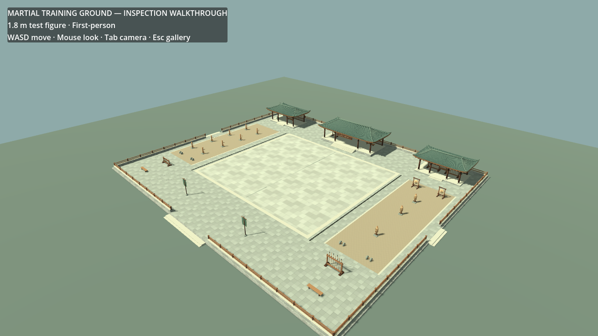
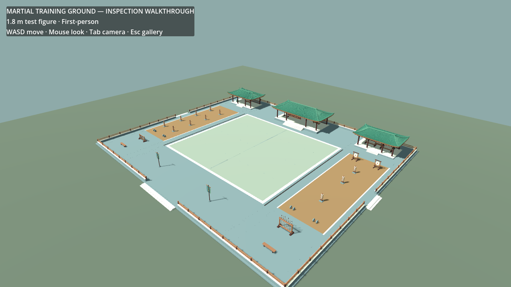
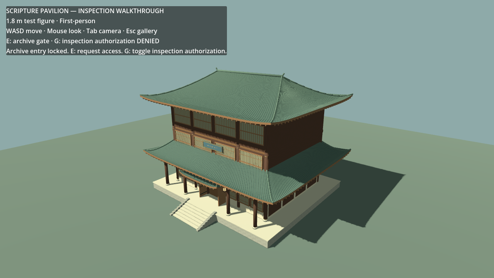
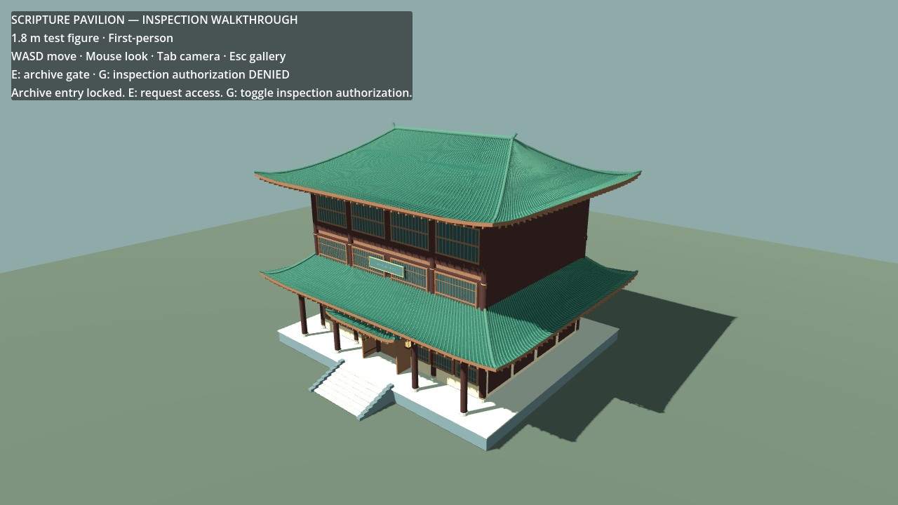
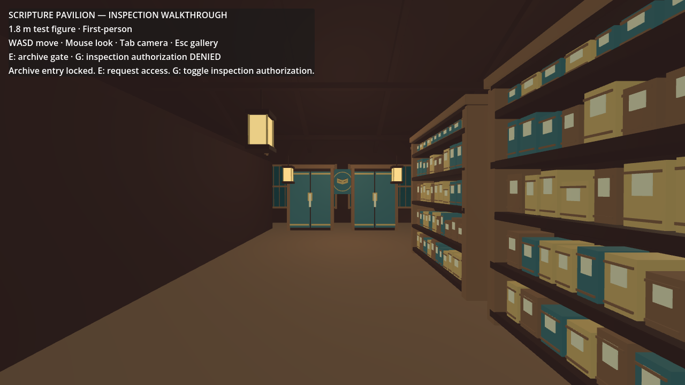

# Stages 2–3: Training Ground and Scripture Pavilion

22 October 2026. Latest user instruction authorizes these two existing facilities and associated assets. The approved Main Sect Hall and stage-1 Gate are preserved. This is a four-facility workshop, not an assembled town.

## Completed conversion and preservation

Stage 2: seven Training equipment types first, then near/LOD shelters and court. Stage 3: six library furnishing types and both archive leaves first, then near/LOD Pavilion architecture. Original silhouettes and architectural identities remain: open martial court with three low shelters versus tall three-storey library. No Hall architecture was copied across buildings. All 19 GLBs now use opaque texture-free palette materials and verified flat exported normals. Existing low-count equipment/furniture geometry was retained; shallow roof/frame subdivision was dissolved without collapse decimation. Building/prop imported bounds match baseline within 0.0001 m. Feet and hinge origins retain their original coordinates.

All existing runtime scripts, scenes, controllers/cameras, physical JSONs, light rigs and project settings remain byte-identical to the pre-stage manifest. Training's four recognized paving node names, shadow-off behavior, LOD bias and repaired thin ground geometry remain. MultiMesh placement remains governed by the unchanged JSON and scripts. No extra lights, shader effects, textures or production gameplay systems were introduced.

Palette follows the approved Hall. Two restrained ground roles extend it: Earth #806b50 and CourtStone #81938d; small coping/nosings retain the pale Hall color. Library bindings use the existing teal fabric, cedar and bronze hues; paper uses plaster. Material values repeat across GLBs, but cross-file GPU resource sharing is not claimed.

The first Training iteration exposed inherited custom split normals and an overly pale court. Clearing the stored custom normals fixed exported flat shading; a muted court material corrected the large white field. That discarded benchmark/captures remain in `environment-conversion-stages-2-3/training-initial-iteration/`; only the final iteration appears below. A separate Pavilion audit traced near-zero visual triangles to near-coincident endpoints already present in its original Timber batch (104 near-zero, 16 exactly zero). A targeted 2 micrometre seam weld at input, before triangulation, removed those redundant endpoints without changing the visible envelope or collider; output was re-audited and gameplay/benchmarks rerun. Diagnosis JSONs and the discarded Pavilion iteration are retained in the evidence folder. A type-inference error in a new envelope test was corrected and the test rerun. No asset runtime code was changed to make tests pass.

## Actual model counts

The preserved JSON contains historical counts. Current statistics are in per-facility `low_poly_stage_metrics.json`, actual GLBs, and the following audit; original textures remain unused on disk for recovery.

| Model | Triangles before → after | Surfaces before → after | Embedded images before → after |
| --- | --- | --- | --- |
| training/arm_dummy.glb | 544 → 544 | 3 → 3 | 6 → 0 |
| training/martial_training_ground.glb | 94,776 → 88,020 | 16 → 13 | 26 → 0 |
| training/martial_training_ground_lod.glb | 13,998 → 12,913 | 16 → 13 | 26 → 0 |
| training/rest_bench.glb | 264 → 264 | 3 → 3 | 7 → 0 |
| training/staff_rack.glb | 868 → 868 | 5 → 4 | 9 → 0 |
| training/stone_weight.glb | 100 → 100 | 2 → 2 | 6 → 0 |
| training/striking_post.glb | 2,820 → 2,820 | 4 → 4 | 10 → 0 |
| training/sword_rack.glb | 916 → 916 | 3 → 3 | 7 → 0 |
| training/thrust_target.glb | 504 → 504 | 4 → 4 | 9 → 0 |
| pavilion/archive_gate_left.glb | 124 → 124 | 5 → 4 | 5 → 0 |
| pavilion/archive_gate_right.glb | 124 → 124 | 5 → 4 | 5 → 0 |
| pavilion/library_lantern.glb | 168 → 168 | 4 → 3 | 3 → 0 |
| pavilion/reading_stool.glb | 220 → 220 | 2 → 2 | 5 → 0 |
| pavilion/reading_table.glb | 468 → 468 | 4 → 4 | 7 → 0 |
| pavilion/scripture_pavilion.glb | 118,720 → 110,960 | 12 → 11 | 17 → 0 |
| pavilion/scripture_pavilion_lod.glb | 30,016 → 22,248 | 11 → 11 | 17 → 0 |
| pavilion/scripture_shelf.glb | 2,984 → 2,984 | 6 → 5 | 7 → 0 |
| pavilion/scroll_cabinet.glb | 2,600 → 2,600 | 4 → 4 | 7 → 0 |
| pavilion/sealed_cabinet.glb | 272 → 272 | 5 → 5 | 7 → 0 |

Assembled near geometry including repeated props: Training 114,148 → 107,392; Pavilion 187,196 → 179,436. These are isolated facilities, not a whole-world render budget. The dense roof ribs remain; not every visual triangle has been aggressively reduced.

## Executed verification

| Check | Result |
| --- | --- |
| Training rendered functional/camera/collision suite | 86 PASS / 0 FAIL |
| Training imported envelopes / protected ground contracts | 13 PASS / 0 FAIL |
| Training reopened editable Blender source | 5 PASS / 0 FAIL |
| Training independent uncached project functional run | 65 PASS / 0 FAIL |
| Pavilion rendered functional/camera/collision suite | 114 PASS / 0 FAIL |
| Pavilion imported envelopes / protected ground contracts | 10 PASS / 0 FAIL |
| Pavilion reopened editable Blender source | 5 PASS / 0 FAIL |
| Pavilion independent uncached project functional run | 102 PASS / 0 FAIL |
| Training equipment subgroup | 65 PASS / 0 FAIL; 7 bounds PASS |
| Pavilion furniture/leaf subgroup | 102 PASS / 0 FAIL; 8 bounds PASS |
| Gallery, Tab, mouse look, E/G, Esc input | 17 PASS / 0 FAIL |
| Preserved Gate gameplay and camera regression | 16 PASS / 0 FAIL |
| Preserved Gate input regression | 7 PASS / 0 FAIL |
| Approved Hall dimensions/camera regression | 18 PASS / 0 FAIL |
| Approved Hall input regression | 7 PASS / 0 FAIL |
| Independent rendered review inputs | 17 PASS / 0 FAIL |
| Independent default Hall + Training/Pavilion scene startup | PASS; uncached import and actual rendered processes |
| Original project preservation | 1599 recorded non-cache hashes match |
| Hall/Gate and existing runtime scripts/scenes/settings/physical JSON | Pre-stage hashes match |
| 19 converted GLBs | Finite positions, unit/flat normals, opaque, no textures, no near-zero triangles at audit tolerance |

Functional suites use the unchanged 1.8 m/.28 m inspection capsule, 4 m/s movement, and real `move_and_slide`. Fixed-fps 60 is used only to advance reproducible functional rehearsals; their timings are not benchmarks. Training checks formation-court support, side lanes, entrances, instructor dais, shelters, equipment obstruction, standalone props and camera retraction. Pavilion checks 486 visual-mesh stair-headroom volumes, both stairways, ordinary and archive routes, gate collision, remote rejection, no-provider/default denial, authorization, revocation while open, safe closing, denied follow-through, egress after revocation and sensor mask restoration. Cameras are sampled along those tested paths. Input tests send real programmatic Tab/mouse/E/G/Esc events and use existing gallery Walk routes. This is not a human playtest or production controller test.

Important retained limitation: the Training roof collider already contains 84 zero-area triangles among 4,560 entries. They exist in the frozen baseline and remain unchanged; no root-cause collision repair or benefit is claimed for them. Solid collision coverage and motion pass on tested routes. Pavilion has 4,504 roof triangles with no zero-area entries. The approved Hall's earlier repair remains at 2,368 valid triangles; it was not regenerated. Future Training collider work must diagnose the source and prove valid-face/coverage equivalence before editing.

## Matched local rendered benchmarks

Godot 4.7.2, NVIDIA GeForce RTX 3050 Laptop GPU, GL Compatibility, 1280×720, MSAA 4x, uncapped and VSync disabled. Existing per-facility environment/light rigs are identical before/after: ambient .55; sun shadow range 180 m Training and 100 m Pavilion; Pavilion's six original unshadowed lights retained. Both modes use the unchanged inspection cameras. Each view warms 45 frames and measures 240. Separate rendered processes run sequentially, without concurrent import/conversion/audit workloads. First round runs baseline then converted; second round reverses that order. Exact poses, frame samples, draw/primitive/object counters and VRAM values are in the four before/after JSON pairs. Frame times are wall-clock application frame intervals, not isolated GPU timer queries.

| Facility | Round | View | Mean ms before → after | P95 ms before → after | FPS before → after | Draw calls before → after | Primitives before → after |
| --- | --- | --- | --- | --- | --- | --- | --- |
| training | 1 | overview | 9.59 → 5.52 | 19.92 → 13.22 | 104.3 → 181.1 | 120.0 → 108.0 | 305,132 → 283,952 |
| training | 1 | court | 7.31 → 9.66 | 14.30 → 16.62 | 136.9 → 103.6 | 164.0 → 146.0 | 455,338 → 426,362 |
| training | 1 | shelter | 6.63 → 12.93 | 13.27 → 26.46 | 150.8 → 77.4 | 88.0 → 77.0 | 388,070 → 361,862 |
| training | 1 | 360 sweep | 5.64 → 8.33 | 11.55 → 14.95 | 177.3 → 120.0 | 117.6 → 105.9 | 356,623 → 343,280 |
| training | 1 | first-person | 4.77 → 9.04 | 10.63 → 15.15 | 209.8 → 110.6 | 115.0 → 103.0 | 350,582 → 330,232 |
| training | 1 | third-person | 5.91 → 10.42 | 11.18 → 18.95 | 169.2 → 95.9 | 121.0 → 107.0 | 364,946 → 344,426 |
| training | 2 | overview | 5.42 → 7.77 | 11.47 → 15.37 | 184.6 → 128.7 | 120.0 → 108.0 | 305,132 → 283,952 |
| training | 2 | court | 6.11 → 9.94 | 12.24 → 18.34 | 163.7 → 100.6 | 164.0 → 146.0 | 455,338 → 426,362 |
| training | 2 | shelter | 6.14 → 10.80 | 12.37 → 21.02 | 162.9 → 92.6 | 88.0 → 77.0 | 388,070 → 361,862 |
| training | 2 | 360 sweep | 5.49 → 8.49 | 11.63 → 17.70 | 182.2 → 117.8 | 117.6 → 105.9 | 356,623 → 343,280 |
| training | 2 | first-person | 5.84 → 10.00 | 12.11 → 20.34 | 171.3 → 100.0 | 115.0 → 103.0 | 350,582 → 330,232 |
| training | 2 | third-person | 6.53 → 11.92 | 12.37 → 20.68 | 153.1 → 83.9 | 121.0 → 107.0 | 364,946 → 344,426 |
| pavilion | 1 | overview | 9.09 → 6.51 | 19.96 → 15.04 | 110.0 → 153.6 | 152.0 → 137.0 | 404,940 → 387,540 |
| pavilion | 1 | ground-library | 24.27 → 7.76 | 41.05 → 19.52 | 41.2 → 128.8 | 213.0 → 196.0 | 674,760 → 640,772 |
| pavilion | 1 | ordinary-gallery | 20.61 → 7.55 | 38.44 → 14.78 | 48.5 → 132.4 | 148.0 → 138.0 | 528,682 → 502,178 |
| pavilion | 1 | archive | 22.84 → 6.25 | 38.21 → 11.51 | 43.8 → 160.0 | 196.0 → 180.0 | 657,418 → 624,074 |
| pavilion | 1 | 360 sweep | 17.48 → 4.63 | 26.81 → 10.15 | 57.2 → 215.8 | 139.4 → 126.5 | 472,516 → 448,749 |
| pavilion | 1 | first-person | 20.88 → 8.26 | 42.35 → 17.90 | 47.9 → 121.1 | 217.0 → 199.0 | 679,200 → 647,220 |
| pavilion | 1 | third-person | 27.88 → 6.26 | 39.20 → 11.23 | 35.9 → 159.6 | 240.0 → 218.0 | 711,668 → 679,760 |
| pavilion | 2 | overview | 6.41 → 8.08 | 12.29 → 14.69 | 156.0 → 123.8 | 152.0 → 137.0 | 404,940 → 387,540 |
| pavilion | 2 | ground-library | 9.30 → 9.50 | 14.48 → 14.42 | 107.6 → 105.3 | 213.0 → 196.0 | 674,760 → 640,772 |
| pavilion | 2 | ordinary-gallery | 10.18 → 3.75 | 22.55 → 4.21 | 98.3 → 266.9 | 148.0 → 138.0 | 528,682 → 502,178 |
| pavilion | 2 | archive | 15.50 → 3.59 | 37.67 → 4.15 | 64.5 → 278.3 | 196.0 → 180.0 | 657,418 → 624,074 |
| pavilion | 2 | 360 sweep | 7.65 → 2.68 | 14.23 → 3.25 | 130.7 → 373.7 | 139.4 → 126.5 | 472,516 → 448,749 |
| pavilion | 2 | first-person | 14.98 → 4.25 | 42.38 → 6.59 | 66.7 → 235.2 | 217.0 → 199.0 | 679,200 → 647,220 |
| pavilion | 2 | third-person | 7.05 → 4.13 | 12.63 → 9.55 | 141.8 → 242.1 | 240.0 → 218.0 | 711,668 → 679,760 |

Training is slower in most views in both rounds despite lower draw/triangle counts; treat this as a measured performance regression requiring profiling before further expansion. Pavilion timings improve in the recorded comparisons. A separate accessor audit (`environment-conversion-stages-2-3/vertex-cost-comparison.json`) finds static near vertex counts increasing from 170,012 to 216,685 for Training and 223,016 to 264,629 for Pavilion after explicit flat shading. This is a candidate cost, not a proven explanation of the timing difference. No consistent cross-facility FPS improvement is claimed. No lighting/shadow setting was changed, and isolated shadow cost was not profiled; total scene timings include it. No representative low-end, sustained thermal, exported executable or populated-world test was performed. Historical Hall and stage-1 Gate measurements remain in their own reports; they are different scenes, not numerical baselines for these facilities.

## Genuine screenshots and review

Training original versus converted (same camera/lighting):

Pavilion original versus converted:

Converted Pavilion interior:

Every benchmark has additional exterior/interior/FPP/TPP images. Rendered regression folders show close equipment, stairs, gate denial/entry and camera boundaries. Current gallery captures show the preserved Hall/Gate and both converted facilities; previous stage-1 captures retain the genuine unconverted state. Visual inspection found the intended palette/flat treatment, intact silhouettes, readable equipment/book bindings and preserved walkable openings in inspected views. No exhaustive pixel-level intersection, every camera orientation or distance-transition examination was performed. Dense roof ribs can alias at distance; they were retained to protect existing silhouettes rather than silently rebuilding roofs.

## Recovery and exact next action

Baseline originals: `baseline/stage23_training/` and `baseline/stage23_pavilion/` plus local baseline scripts/scene adapters. Checkpoint: `checkpoints/before-environment-stages-2-3.zip`. New editable sources: `source/martial_training_ground_low_poly.blend` and `source/scripture_pavilion_low_poly.blend`. Original runtime recovery and all earlier checkpoints remain intact. No original high-detail asset was deleted.

Launch `Review Training Ground.cmd` / `Review Scripture Pavilion.cmd`, or gallery → facility → Walk asset. WASD/mouse, Tab FPP/TPP, Esc gallery; Pavilion E requests archive access, G toggles only the inspection permission provider. Main project still opens the approved Hall by default. Current final audit is `tools/finish_facility_stages.py`, not a historical Hall/gate report writer.

Claude's next action: profile the Training frame-time regression under the same matched conditions before starting another conversion; separate vertex/shader/shadow cost from host timing variation. Preserve the current converted design and rollback before experiments. Manually review these two converted facilities using the launchers and record actual observations separately from automation. Rehearse the Training front/dais/side lanes and Pavilion entrance, east ordinary stair, west archive stair, denied/authorized/revoked/egress flow in both cameras. Investigate the 84 inherited Training roof degenerates in a separate reversible collider stage with valid-face/coverage proof. Do not invent/integrate a town: terrain, paths, vegetation, residences/shops and production-world QA require the real supplied world source first. Do not claim whole-town or low-end completion.
