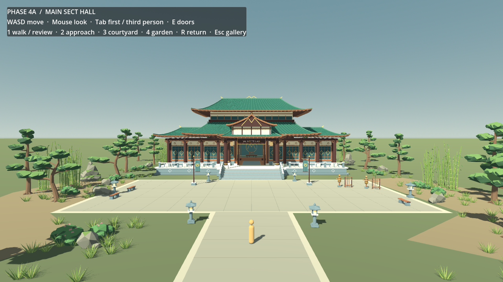
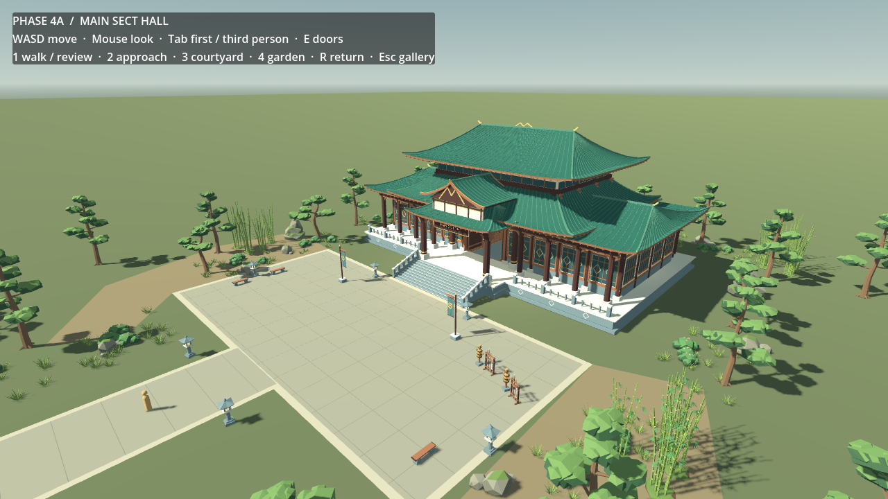
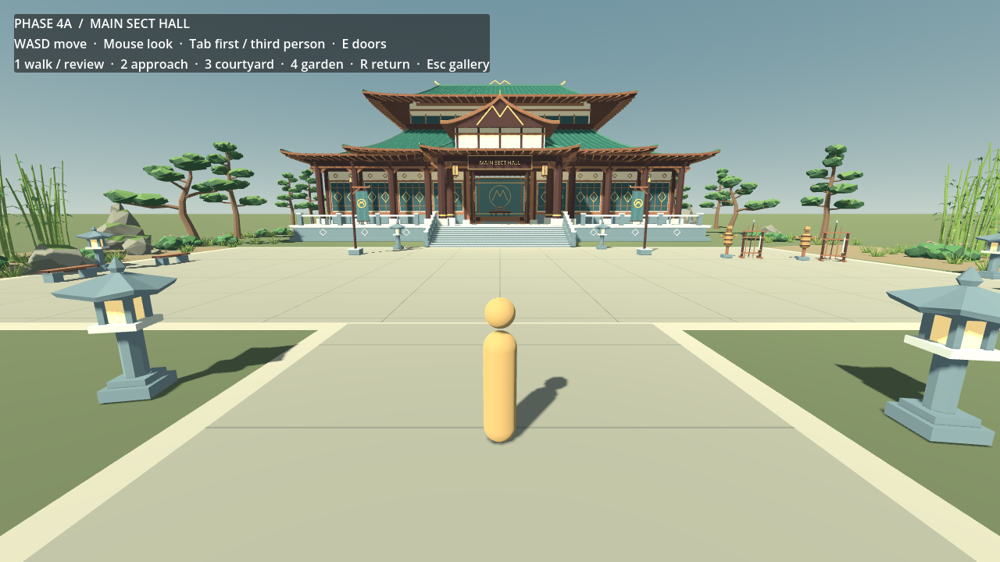

# Phase 4A — Main Sect Hall environment assembly

23 October 2026. Separate proposal scene, ready for visual review.

## Launch

Double-click **View Phase 4A Main Sect Hall.cmd** at the workspace root. Alternatively, open `prototype/CultivationSect_LowPoly_Test/project.godot`, open `res://phase4a/main_sect_hall_environment.tscn`, and press **F6** (Run Current Scene). F5 retains the project's existing Hall review startup.

Starts walking in third person. **WASD** move, **mouse** look, **Tab** first/third person, **E** existing Hall doors, **1** walk/review, **2** approach view, **3** courtyard view, **4** garden view, **R** return to the approach, **Esc** existing gallery. Resume walking with **1** after any review view. The entrance starts open in this scene only.

## Changes

- A south-facing 7.6 m stone approach connects to a 42 × 21 m bordered courtyard and the existing Hall stairs. Fine paving joints add scale without raised trip edges.
- West-side seating and rock gardens, an east-side two-station practice pocket, entrance banners and lanterns establish uses around a clear centre.
- Asymmetric pine groups, uneven bamboo groves, boulders, shrubs and grass frame the Hall. Front stairs, entrance sightline and main walking routes remain open.
- **304 instances of the eleven existing environmental scenes:** 22 pines (7 windswept / 15 tiered), 21 bamboo, 33 shrubs, 201 grass tufts, 8 boulder clusters, 4 outcrops, 8 lanterns, 2 banners, 2 dummy/rack sets and 3 benches. Nature varies in yaw and uniform scale within the asset report's limits; furnishings remain scale 1.
- All prop placements are explicit nodes in the new `.tscn`. Ground surfaces, lighting, controls for this assembly and the unchanged controller instance are supplied by its companion script. Assets are referenced directly from their existing staged `.tscn` files, preserving their supplied collision.

## Preserved scope

The working root was verified from its Hall handoff, canonical scene and batch-1 report. Before assembly, the batch-1 review scene/script/contact sheet and the original 2D map's layout data, architecture placement, Phase 3B overview and map contract were inspected.

The canonical Hall remains at identity transform and original dimensions: approximately **41.684 × 30.18 × 18.31 m** (width × depth × height). Its corrected collision JSON, model, materials, doors and scripts are reused without editing. The existing player/camera source, gallery, settings, other buildings, staging assets, original `asset-workshop` production project and original 2D map are preserved. Ground and courtyard coordinates are local to this standalone scene; they do not establish new town coordinates or move any 2D district. No other building was placed.

## Focused demonstration checks

The initial headless smoke check passed **17 / 0**; the final rendered check passed **23 / 0**, including five saved screenshots. Results are in [rendered-results.json](phase4a/rendered-results.json). Checks cover startup, actual W input, Tab switching, overview/resume, safe return, all eleven asset types, unchanged Hall transform and short walking routes: approach → courtyard → original stairs → Hall entrance → courtyard, plus seating and practice pockets. These use the existing controller's movement and physics. No full gallery suite or exhaustive collision sweep was run.

The first rendered pass exposed reversed ground-face winding; this was corrected. The visible background ground edge was then moved beyond the review views, and the third-person capture was moved back to include more of the architecture. Final PNGs were inspected after these changes. SHA-256 comparisons confirmed **5,752 existing test-project files, 1,599 original-project files and 196 original map files unchanged**. Evidence is in [preservation.json](phase4a/preservation.json); the snapshot is [before-hashes.json](phase4a/before-hashes.json). Generated engine cache files are excluded.

## Screenshots

Additional views: [first person](phase4a/04-first-person-approach.png), [garden corner](phase4a/05-garden-corner.png).

## Known limitations and stop point

This is one flat-ground proposal area with the existing inspection avatar. It is not a whole town, final terrain integration or a human-accepted design. The surrounding meadow is a backdrop; the supporting demo floor is 240 × 240 m. Use R if wandering beyond it. Foliage retains its supplied limited/no collision, so cameras can enter foliage away from the clear demonstration routes. Grass and shrubs are brush-through. Existing unrelated Hall trim/camera limitations were not investigated.

No new environmental asset, LOD, wind, collision system, navigation, NPC, gameplay, export or performance certification was added. The initial headless run logged the previously known host certificate-store diagnostic; the final rendered log records current diagnostics. Physical keyboard/mouse rehearsal by the user remains pending. Work stops at this Hall area for visual review.

Implementation: `phase4a/main_sect_hall_environment.tscn`, `phase4a/main_sect_hall_environment.gd`. Supporting additive tools: `phase4a/build_assembly.py`, `phase4a/smoke_review.gd`, `phase4a/check_preservation.py`. No pre-existing handoff/report was overwritten.
